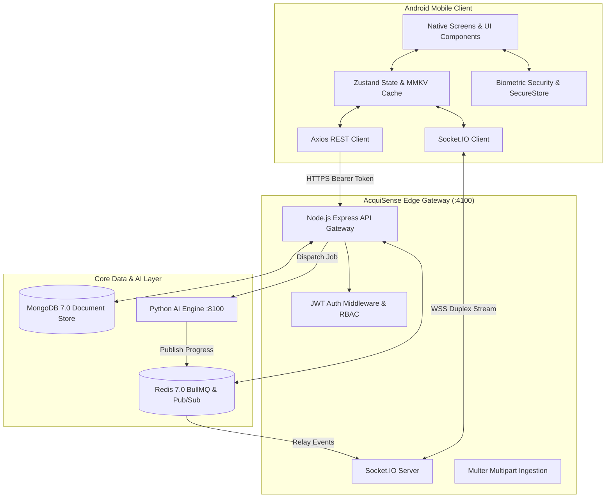

# AcquiSense Android Mobile Application
## Complete Architectural Blueprint, Technical Specification & Engineering Roadmap

---

## 1. Executive Overview & Mobile Strategy

### 1.1 The Mobile Diligence Paradigm
In institutional Mergers & Acquisitions (M&A) and Private Equity (PE), investment decisions are rarely made sitting at a desk. Dealmakers, Corporate Development VPs, and Investment Committee (IC) partners are constantly on the move—traveling between target facility inspections, participating in confidential management presentations, and negotiating in boardrooms.

The **AcquiSense Android Mobile App** brings the full power of our **16-agent autonomous due diligence fleet** into the palm of the partner's hand, solving three mission-critical friction points:

1. **Information Asymmetry During In-Person Management Meetings**: Partners can review AI-generated management interview questions with explicit red-flag guidelines on their phones while sitting across the table from the target CEO and CFO.
2. **Instant Threat Notification**: Real-time push notifications alert partners the moment an autonomous multi-agent analysis finishes or an existential **P0 Critical Risk** (e.g., hidden IP contamination or customer concentration cliff) is surfaced.
3. **Pocket Deal Copilot**: A conversational, citation-grounded RAG assistant that answers high-stakes valuation, legal, and operational questions with sub-second latency before a partner walks into a boardroom.

```
┌────────────────────────────────────────────────────────────────────────────────────────┐
│                          ACQUISENSE MOBILE PRODUCT PILLARS                             │
├──────────────────────────┬─────────────────────────────┬───────────────────────────────┤
│ 1. REAL-TIME TELEMETRY   │ 2. POCKET COPILOT & IC Q&A  │ 3. RAPID RAC TRIAGE           │
├──────────────────────────┼─────────────────────────────┼───────────────────────────────┤
│ • Socket.IO live gauges  │ • Offline-first RAG chat    │ • Swipe-to-review HITL        │
│ • Push alerts on P0/Done │ • Management interview prep │ • One-tap analyst assignment  │
│ • 9-agent concurrency    │ • Interactive citations     │ • Biometric-locked covenants  │
└──────────────────────────┴─────────────────────────────┴───────────────────────────────┘
```

---

## 2. Technology Stack & Framework Selection

### 2.1 Technology Evaluation Matrix

| Criterion | React Native + Expo SDK 52 *(Selected)* | Capacitor (Ionic) | Native Kotlin + Jetpack Compose |
| :--- | :--- | :--- | :--- |
| **Logic Reusability** | **~75%** (API contracts, auth, schemas, Socket.IO) | ~95% (Web code reuse) | 0% (Complete rewrite) |
| **UI Performance** | **60–120 FPS** (Native views + Skia engine) | 30–60 FPS (WebView DOM bottlenecks) | **120 FPS** (Pure native rendering) |
| **List Performance** | **Exceptional** (`@shopify/flash-list` for 100+ findings) | Poor on complex DOM node trees | **Exceptional** (`LazyColumn`) |
| **Biometrics & Security** | **Hardware-backed** Keystore / Keyguard | Plugin dependent | Native Android Keystore |
| **Development Speed** | **Fast (2–3 weeks to production APK)** | Ultra-fast (3–5 days) | Slow (6–8 weeks) |
| **Offline Storage** | **Ultra-fast C++ MMKV + SQLite** | IndexedDB (unreliable storage limits)| Room SQLite Database |
| **Cross-Platform** | **Android + iOS simultaneously** | Android + iOS | Android only |

### 2.2 Selected Mobile Tech Stack

```
┌────────────────────────────────────────────────────────────────────────────────────────┐
│                              MOBILE TECHNOLOGY STACK                                   │
├─────────────────────────┬──────────────────────────────────────────────────────────────┤
│ Core Framework          │ React Native 0.76+ with Expo SDK 52 (New Architecture: Turbo)│
│ Language                │ TypeScript 5.5+ (Strict Type Checking)                       │
│ Navigation              │ Expo Router v4 (File-based routing with deep-link support)   │
│ State Management        │ Zustand (Ephemeral UI & Auth) + TanStack React Query v5 (API)│
│ High-Performance Lists  │ @shopify/flash-list (Virtualization for 150+ findings)       │
│ Design & Styling        │ NativeWind v4 (Tailwind CSS for React Native) + Glass Tokens │
│ Gestures & Animations   │ React Native Reanimated 3 + Gesture Handler                  │
│ Data Visualization      │ React Native Skia + React Native SVG (D3 Force Graph)        │
│ Real-Time Streaming     │ socket.io-client v4 (Background resilient WebSocket manager) │
│ Offline Persistence     │ react-native-mmkv (100x faster than AsyncStorage) + SQLite   │
│ Security & Biometrics   │ expo-local-authentication + expo-secure-store (Hardware Key) │
│ Push Notifications      │ expo-notifications + Firebase Cloud Messaging (FCM)          │
│ Ingestion & Files       │ expo-document-picker + expo-file-system                      │
└─────────────────────────┴──────────────────────────────────────────────────────────────┘
```

---

## 3. System Architecture & Mobile Networking Topology

The mobile application acts as a secure, authenticated client to the existing AcquiSense microservices infrastructure. **No backend modifications are required**; the Android client consumes the same REST endpoints, WebSocket event streams, and JWT authentication flows.



---

## 4. Comprehensive Mobile Feature Breakdown

### 4.1 Screen 1: Biometric Authentication & Tenant Security

M&A deals involve material non-public information (MNPI). The mobile app implements enterprise-grade security upon launch:

- **Biometric Unlock Gate**: Supports Android BiometricPrompt (Fingerprint, Face Unlock, and device PIN) via `expo-local-authentication`. Even if an analyst leaves their phone unlocked, AcquiSense prompts for biometric re-verification upon opening or after 60 seconds of backgrounding.
- **Hardware-Backed JWT Storage**: JWT auth tokens are encrypted using `expo-secure-store`, storing secrets inside the Android Keystore system.
- **Screenshot & Screen Recording Prevention**: Native window flag `FLAG_SECURE` is active on production builds, preventing Android OS screenshot capture or recent-tasks preview leakage.

---

### 4.2 Screen 2: Executive Deal Pipeline (Mobile Dashboard)

The pipeline overview provides a high-density, touch-optimized summary of all active and historical deals:

```
┌──────────────────────────────────────────┐
│  AcquiSense Mobile        [🔔 2]  [👤]   │
├──────────────────────────────────────────┤
│  🔍 Search deals, targets...             │
├──────────────────────────────────────────┤
│  [All (12)]   [Analyzing (2)]  [Done (9)]│
├──────────────────────────────────────────┤
│ ┌──────────────────────────────────────┐ │
│ │ PROJECT CYBERSEC ACQUISITION         │ │
│ │ Target: Apex Cloud Inc.              │ │
│ │ Acquirer: Horizon Capital            │ │
│ │                                      │ │
│ │   [ NO-GO ]     Risk Score: 8.6/10   │ │
│ │                                      │ │
│ │  ● P0: 2   ● P1: 5   ● P2: 12        │ │
│ │  🕒 Completed 2h ago · 84 findings   │ │
│ └──────────────────────────────────────┘ │
│ ┌──────────────────────────────────────┐ │
│ │ PROJECT QUANTUM FINTECH              │ │
│ │ Target: PayFlow Global               │ │
│ │                                      │ │
│ │   [ ANALYZING 68% ]                  │ │
│ │  ⚡ 6 of 9 agents complete...         │ │
│ └──────────────────────────────────────┘ │
│                                          │
│ [+] NEW DEAL INGESTION                   │
└──────────────────────────────────────────┘
```

- **Deal Cards**: Dynamic border glow matching the deal verdict:
  - **Red Glow**: `NO-GO`
  - **Amber Glow**: `CAUTION`
  - **Emerald Glow**: `GO`
  - **Cyan Pulse**: `ANALYZING` (with live animated progress bar)
- **Haptic Pull-to-Refresh**: Re-queries the API with subtle haptic ticks (`expo-haptics`).

---

### 4.3 Screen 3: Live Diligence Mission Control (Real-Time Telemetry)

When an analysis is running, the mobile app connects to the dedicated Socket.IO room (`job:<pythonJobId>`):

- **Circular Progress Dials**: A 3x3 grid of animated circular progress bars for all 9 domain specialists (`Legal`, `Finance`, `Commercial`, `Tech`, `Cyber`, `HR`, `Tax`, `Regulatory`, `ESG`).
- **Live Terminal Feed**: A collapsible glassmorphic drawer showing the current pipeline stage (`ingesting` $\rightarrow$ `analyzing` $\rightarrow$ `synthesizing` $\rightarrow$ `quality_check` $\rightarrow$ `generating_report`).
- **Background Completion Alert**: If the partner minimizes the app, Android sends a high-priority push notification upon completion:  
  *`"AcquiSense: Analysis complete for Apex Cloud. Overall verdict: NO-GO."`*

---

### 4.4 Screen 4: Deal Dossier & The 8 Core Tabs (Mobile UX)

```
┌────────────────────────────────────────────────────────┐
│  ← Project Apex Dossier                   [⚡ Copilot] │
├────────────────────────────────────────────────────────┤
│ [Verdict] [Findings] [Heatmap] [Graph] [Q&A] [Action]  │
└────────────────────────────────────────────────────────┘
```

#### Tab 1: Verdict & Executive Summary
- **Verdict Ring**: Animated SVG circular risk gauge displaying overall score (0.0 to 10.0 scale) and the definitive `GO` / `CAUTION` / `NO-GO` badge.
- **Executive Memo Card**: Formatted Markdown card synthesizing the Investment Committee narrative written by the GPT-4o Synthesis Agent.
- **Severity Distribution Bar**: Interactive segmented bar showing proportion of P0, P1, P2, and P3 findings.

#### Tab 2: Findings Matrix (`@shopify/flash-list`)
- **Virtualization for 100+ Findings**: Smooth 60fps scrolling across extensive finding lists.
- **Filter Pills**: One-tap toggles for `P0`, `P1`, `P2`, `P3`, and the 9 domain categories.
- **Finding Card**: Displays severity pill, title, domain badge, and preview excerpt.
- **Citation Drawer (Bottom Sheet)**: Tapping a finding slides up a native bottom sheet (`@gorhom/bottom-sheet`) revealing the full finding description, evidence, and exact document citations with highlighted quotes.

#### Tab 3: Risk Heatmap Matrix
- **Mobile Segmented Heatmap**: Adapted from the desktop grid into an intuitive domain-by-domain severity distribution chart.
- **Color Intensity**: Visual depth indicators representing risk concentration across legal, financial, and technical domains.

#### Tab 4: Cross-Domain Network Graph
- **Interactive Force-Directed Physics**: Rendered using **React Native Skia** and `d3-force`.
- **Touch Gestures**: Pinch-to-zoom, pan, and tap-to-inspect nodes representing linked cross-domain findings.
- **Compound Risk Cards**: Carousel of narrative cards explaining how two disparate findings combine into a material deal liability.

#### Tab 5: Pocket Analyst Questions (IC Flashcards)
- **Management Meeting Prep**: Domain-categorized cards providing high-impact questions for the target company's C-suite.
- **Forensic Breakdown**:
  - `Question`: The exact question to ask the CEO or CFO.
  - `Rationale`: Why this question matters based on data room evidence.
  - `What to Look For`: Satisfactory responses vs. evasive red flags.

#### Tab 6: Risk Action Center (HITL Workflow)
- **Swipe-to-Triage Gestures**:
  - **Swipe Right**: Confirm AI finding (`confirmed`).
  - **Swipe Left**: Reject false positive (`rejected`).
  - **Tap**: Open workflow state transition modal (`open` $\rightarrow$ `assigned` $\rightarrow$ `remediating` $\rightarrow$ `verified` $\rightarrow$ `closed`).
- **Analyst Assignment**: Assign tasks to team members with date picker for remediation deadlines.
- **Audit Log Modal**: Full history trail of who approved or modified each finding.

#### Tab 7: Document Comparator
- **Side-by-Side Clause Diff**: Compares two data room documents with visual indicators:
  - Green border: `New Risk Clause`
  - Amber border: `Clause Modified`
  - Red border: `Removed Protection`
- **Risk Trajectory Indicator**: Displays whether the deal risk profile is `improving`, `deteriorating`, or `stable`.

#### Tab 8: Agent Grid
- Detailed telemetry table showing runtime duration, token counts, and findings discovered for each of the 9 domain agents.

---

### 4.5 Screen 5: Pocket Deal Copilot (Conversational Drawer)

- **Floating Lightning Action Button (FAB)**: Accessible from any tab within a deal.
- **Mobile Chat Interface**: Instant messaging UI designed for one-handed operation.
- **Streaming Responses**: Token-by-token streaming markdown responses.
- **Interactive Citation Chips**: Citations appear as clickable pills that open the exact source document reference in a popover.
- **Prompt Catalog**: Quick-tap chips for common mobile inquiries:
  - *"Show all P0 and P1 risks"*
  - *"What items affect valuation?"*
  - *"What should I ask the CFO?"*

---

### 4.6 Screen 6: Mobile VDR Ingestion & Camera Scanner

- **Cloud & Local File Picker**: Upload PDF contracts, Excel spreadsheets, and Word documents directly from phone storage, Google Drive, or OneDrive via `expo-document-picker`.
- **Camera Document Capture**: Take photos of physical contract pages during on-site diligence; converted into PDF and uploaded to the VDR.
- **Multi-File Upload Progress**: Multi-file parallel upload progress bar communicating with `POST /api/upload`.

---

## 5. Security, Privacy & Enterprise Compliance

```
┌────────────────────────────────────────────────────────────────────────────────────────┐
│                              MOBILE DEFENSE-IN-DEPTH                                   │
├────────────────────────────────────────────────────────────────────────────────────────┤
│ 1. Zero Plaintext Tokens      │ Encrypted in Android Keystore via SecureStore          │
│ 2. Screen Privacy             │ FLAG_SECURE prevents screenshots and app switcher leak │
│ 3. Biometric Re-auth          │ Enforces Fingerprint/Face ID after 60s backgrounding   │
│ 4. Network Security           │ Strict HTTPS / WSS TLS 1.3 with certificate pinning    │
│ 5. Session Timeout            │ Auto-logout on token expiration                        │
│ 6. Sandboxed Storage          │ Offline dossiers cached in encrypted MMKV storage      │
└────────────────────────────────────────────────────────────────────────────────────────┘
```

---

## 6. Offline-First Architecture & Data Synchronization

M&A partners frequently review dossiers on flights or in locations with spotty connectivity:

1. **Local Dossier Caching**: When a deal report is viewed, the full JSON payload is persisted to **MMKV storage** with key `deal_cache_<dealId>`.
2. **Offline Indicator**: When network connectivity is lost (`@react-native-community/netinfo`), the UI gracefully enters offline read-only mode, serving cached findings and reports.
3. **Optimistic Action Center Sync**: If an analyst changes a finding state or writes review notes while offline, actions are queued in a local SQLite sync queue and flushed to `PATCH /api/findings/:id/action` once connectivity resumes.

---

## 7. Project Directory Structure (`/mobile`)

The mobile application will be organized inside a clean `/mobile` directory in the repository:

```
e:\projects\Company acquire\mobile\
├── app/                         # Expo Router File-Based Routing
│   ├── (auth)/                  # Authentication route group
│   │   ├── login.tsx            # Login screen with tenant & password
│   │   └── biometric.tsx        # Biometric unlock prompt screen
│   ├── (tabs)/                  # Main bottom tab navigator
│   │   ├── _layout.tsx          # Tab bar layout configuration
│   │   ├── index.tsx            # Dashboard / Deal pipeline screen
│   │   ├── new-deal.tsx         # New deal creation & file upload
│   │   └── reports.tsx          # Reports archive screen
│   ├── deal/                    # Deal investigation routes
│   │   └── [id].tsx             # Comprehensive 8-tab deal workspace
│   ├── _layout.tsx              # Root app shell with providers & toast
│   └── +not-found.tsx           # 404 screen
│
├── src/                         # Application source code
│   ├── components/              # Modular UI components
│   │   ├── common/              # GlassCard, Button, Badge, SeverityPill
│   │   ├── copilot/             # CopilotChatSheet, CitationChip, PromptCatalog
│   │   ├── dashboard/           # DealCard, StatusFilter, ScoreRing
│   │   ├── deal/                # VerdictTab, FindingsList, HeatmapView
│   │   ├── graph/               # SkiaForceGraph, CompoundRiskCard
│   │   └── questions/           # QuestionFlashCard, AnswerGuideSheet
│   ├── hooks/                   # Custom React hooks
│   │   ├── useBiometrics.ts     # Biometric verification hook
│   │   ├── useDealSocket.ts     # Socket.IO subscription hook
│   │   ├── useOfflineCache.ts   # MMKV caching & sync hook
│   │   └── useCopilot.ts        # Copilot streaming chat hook
│   ├── services/                # Network and storage services
│   │   ├── api.ts               # Axios client with JWT interceptor
│   │   ├── auth.ts              # SecureStore token management
│   │   ├── socket.ts            # Socket.IO connection manager
│   │   └── storage.ts           # MMKV storage instance
│   ├── stores/                  # Zustand global state stores
│   │   ├── useAuthStore.ts      # Authentication & user profile state
│   │   ├── useDealStore.ts      # Active deal, filter & tab state
│   │   └── useTelemetryStore.ts # Real-time agent progress states
│   ├── constants/               # Colors, domain tokens & severity themes
│   │   ├── colors.ts            # Risk and domain color palette
│   │   └── domains.ts           # 9-domain metadata and icons
│   └── types/                   # TypeScript schemas and models
│       ├── deal.ts              # Deal, Job, Finding, Citation types
│       └── copilot.ts           # Chat message and query types
│
├── assets/                      # App icons, splash screens, and fonts
├── app.json                     # Expo configuration manifest (Android package, permissions)
├── package.json                 # Mobile dependencies and build scripts
├── tailwind.config.js           # NativeWind styling configuration
└── tsconfig.json                # TypeScript compiler configuration
```

---

## 8. TypeScript Core Data Models

Shared data types between the mobile client and backend:

```typescript
export type Severity = 'P0' | 'P1' | 'P2' | 'P3';

export type Domain = 
  | 'legal' | 'finance' | 'commercial' | 'tech' 
  | 'cyber' | 'hr' | 'tax' | 'regulatory' | 'esg';

export type WorkflowState = 'open' | 'assigned' | 'remediating' | 'verified' | 'closed';
export type ReviewStatus = 'ai_generated' | 'confirmed' | 'modified' | 'rejected';

export interface Citation {
  file: string;
  page: number;
  section: string;
  quote: string;
}

export interface Finding {
  _id: string;
  pythonFindingId: string;
  dealId: string;
  domain: Domain;
  severity: Severity;
  title: string;
  description: string;
  evidence: string;
  citations: Citation[];
  tags: string[];
  workflowState: WorkflowState;
  reviewStatus: ReviewStatus;
  assignedTo?: string;
  dueDate?: string;
  conditions: Array<{ _id: string; text: string; addedBy: string }>;
  auditLog: Array<{
    action: string;
    by: string;
    at: string;
    notes?: string;
    previousValue?: any;
    newValue?: any;
  }>;
}

export interface Deal {
  _id: string;
  name: string;
  targetCompany: string;
  acquirer: string;
  modelProfile: 'economy' | 'standard' | 'premium';
  status: 'draft' | 'queued' | 'analyzing' | 'done' | 'failed';
  goNoGo: 'GO' | 'CAUTION' | 'NO-GO' | null;
  overallRiskScore: number;
  totalFindings: number;
  latestJobId?: string;
  createdAt: string;
}

export interface AgentProgress {
  domain: Domain;
  status: 'idle' | 'analyzing' | 'done' | 'failed';
  pct: number;
  findingsCount: number;
  error?: string | null;
}
```

---

## 9. Step-by-Step Implementation Roadmap

```
PHASE 1: Scaffolding & Setup        (Days 1–2)  ──► Expo SDK 52, NativeWind, TypeScript, Navigation
PHASE 2: Auth & Biometrics         (Days 3–4)  ──► JWT Auth, SecureStore, BiometricPrompt, Offline Store
PHASE 3: Pipeline & Telemetry       (Days 5–6)  ──► Dashboard, Socket.IO live agent dials, Push notifications
PHASE 4: Deal Dossier & Tabs        (Days 7–10) ──► FlashList findings, Verdict ring, Citations bottom sheet
PHASE 5: Mobile Copilot & RAC       (Days 11–13)──► Conversational RAG chat, Swipe-to-triage HITL workflow
PHASE 6: Skia Graph & Comparator    (Days 14–16)──► Force-directed graph in Skia, Document diff cards
PHASE 7: Testing & APK Generation   (Days 17–18)──► Local Gradle build, EAS Build, release APK / AAB
```

---

## 10. Generating the Android APK

When implementation is complete, generate the production Android build using either **EAS Build** (cloud) or **local Gradle**:

### Method A: Local Android Studio Build (Free & Offline)
```bash
# 1. Generate the native android project folder
npx expo prebuild --platform android

# 2. Build production APK locally via Gradle
cd android
./gradlew assembleRelease

# Output APK location:
# android/app/build/outputs/apk/release/app-release.apk
```

### Method B: Expo Cloud Build (EAS)
```bash
npm install -g eas-cli
eas build --platform android --profile preview
# Downloads directly onto any Android device via QR code
```

---

## 11. Summary & Verification

This architecture provides an **uncompromised, enterprise-grade mobile companion** to AcquiSense. It leverages the existing Node.js API Gateway, MongoDB data models, and Python AI engine with zero backend rework, giving partners and deal teams instant, secure, and offline-capable diligence intelligence anywhere in the world.

