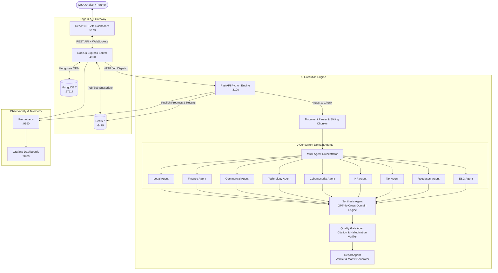

# AcquiSense: Autonomous Multi-Agent M&A Due Diligence Platform
## Complete Technical Guide, Architecture & Operations Manual

---

## 1. Executive Summary & Overview

### 1.1 The Problem
In traditional Mergers & Acquisitions (M&A), due diligence is a massive, multi-week bottleneck:
- **Fragmented Workflows**: Independent legal, financial, accounting, and technical audit teams work in silos with little cross-collaboration.
- **Prohibitive Costs & Slow Turnaround**: Reviews often take **3 to 8 weeks** and cost **$100,000 to $500,000+** in professional advisory fees.
- **Missed Systemic Cross-Domain Risks**: Critical vulnerabilities frequently fall through the cracks when issues span multiple domains (e.g., an unassigned intellectual property clause identified by Legal combined with an open-source software vulnerability flagged by Tech creating an immediate copyright infringement liability).

### 1.2 What We Achieved
**AcquiSense** is an enterprise-grade, autonomous **Multi-Agent Due Diligence Platform** that automates the entire analytical lifecycle:
1. **Multi-Format VDR Ingestion**: Ingests hundreds of Virtual Data Room (VDR) documents (contracts, financial audits, technical designs, compliance filings).
2. **Parallel 9-Agent Analysis**: Orchestrates 9 domain-expert AI agents running concurrently via `asyncio` and LLMs (GPT-4o / GPT-4o-mini).
3. **Cross-Domain Synthesis**: Uses advanced synthesis agents to identify non-obvious, compound risk patterns across domains.
4. **Hallucination Prevention**: Implements automated Quality Gates validating findings against original source document citations.
5. **Actionable Investment Verdict**: Computes an algorithmic **Go / Caution / No-Go** verdict with severity-rated findings (P0–P3), risk heatmaps, and D3 force-directed risk graphs in **under 3 minutes**.

---

## 2. System Architecture & High-Level Design

The platform uses a **polyglot microservices architecture** optimized for high-throughput AI workloads, real-time WebSocket communication, and robust data persistence.



---

## 3. Technology Stack & Tools Used

| Layer | Technology | Version | Purpose & Rationale |
| :--- | :--- | :--- | :--- |
| **Frontend UI** | **React** | 18.2 | Component-driven, responsive user interface with fine-grained state management. |
| **Build Tool** | **Vite** | 5.4 | Ultra-fast Hot Module Replacement (HMR) and optimized development bundler. |
| **Styling** | **Vanilla CSS** | CSS3 | Custom token-based design system with dark mode, glassmorphism, and responsive CSS grids. |
| **Data Viz** | **D3.js** | 7.9 | Interactive Force-Directed network graph displaying cross-domain risk connections. |
| **API Gateway** | **Node.js + Express** | Node 20 LTS | Fast asynchronous API gateway handling file uploads, user sessions, and REST routing. |
| **Real-Time** | **Socket.IO** | 4.7 | Low-latency WebSockets streaming live progress of each individual agent to the UI. |
| **Database** | **MongoDB** | 7.0 | Document store persisting deals, jobs, agent progress, and full analysis reports. |
| **In-Memory** | **Redis** | 7.0 | High-speed message broker for Pub/Sub progress events and ephemeral job state caching. |
| **AI Backend** | **FastAPI (Python)** | 3.11 | High-concurrency asynchronous microservice executing LLM pipelines. |
| **LLM Inference** | **OpenAI API** | GPT-4o / GPT-4o-mini | Domain analysis (mini for efficiency) and synthesis (GPT-4o for deep reasoning). |
| **Data Validation** | **Pydantic** | 2.6 | Strict type enforcement and schema validation across all agent inputs and outputs. |
| **File Parsers** | **PyPDF, python-docx, openpyxl** | Latest | Ingesting raw VDR data across PDF, Word, Excel, and text formats. |
| **Metrics** | **Prometheus** | 2.51 | Scraping operational metrics: active jobs, token counts, agent latency, error rates. |
| **Dashboards** | **Grafana** | 10.4 | Pre-configured operational and system health dashboards. |
| **Infra** | **Docker & Docker Compose** | v2 | Containerized local orchestration with isolated networks and health checks. |

---

## 4. End-to-End Workflow & Core Functionalities

### Step 1: Deal Creation & Document Upload
1. The user navigates to `/new` and defines the deal name, target company, acquirer, and **Model Profile** (`economy`, `standard`, or `premium`).
2. Virtual Data Room (VDR) documents are uploaded via `multer` to `/app/uploads` (PDF, Word, Excel, text).
3. The Node.js gateway registers the deal in MongoDB and dispatches an asynchronous analysis request to the Python backend (`POST /api/analyze`).

### Step 2: Ingestion, Parsing & Sliding-Window Chunking
1. `backend/ingestion/parser.py` dynamically selects the appropriate parser based on file MIME type:
   - **PDFs**: Extracts text with page-level tagging (`file.pdf, Page 4`).
   - **DOCX / TXT / MD**: Extracts hierarchical paragraphs and headings.
   - **XLSX / CSV**: Converts tabular balance sheets and cap tables into formatted string matrices.
2. `backend/ingestion/chunker.py` divides the text into contextual chunks:
   - **Chunk Size**: 1,000 tokens.
   - **Chunk Overlap**: 200 tokens (preserves context across document page boundaries).
   - Every chunk retains metadata: source file, page/row numbers, and character offsets.

### Step 3: Concurrent 9-Domain Agent Execution
The `Orchestrator` uses Python `asyncio.gather()` to launch 9 independent domain agents concurrently:

```
                      ┌─── Legal Agent ───────► Contract breach, IP disputes, litigation
                      ├─── Finance Agent ─────► EBITDA quality, debt covenants, revenue leak
                      ├─── Commercial Agent ──► Customer churn, concentration, TAM
                      ├─── Tech Agent ────────► Tech debt, open-source licenses, infra
Chunks ──► Dispatch ──┼─── Cyber Agent ───────► IAM vulnerabilities, breach records, SOC 2
                      ├─── HR Agent ──────────► Key-man reliance, retention, labor suits
                      ├─── Tax Agent ─────────► Transfer pricing, nexus, state liabilities
                      ├─── Regulatory Agent ──► Antitrust review, FTC/DOJ, environmental
                      └─── ESG Agent ─────────► Carbon footprint, DEI, safety violations
```

- Each agent scans the relevant chunks using specialized system prompts.
- As an agent starts, processes, and finishes, it triggers progress callbacks (`pct: 0% → 50% → 100%`).
- These events are pushed to Redis Pub/Sub: `dd:progress:<job_id>`.
- The Node.js gateway captures Redis messages and pushes them to the browser over WebSockets in real time.

### Step 4: Cross-Domain Synthesis (GPT-4o)
Single-domain findings often look benign in isolation, but become critical when interconnected.
- The `SynthesisAgent` receives all findings from all 9 domains.
- It scans for **Cross-Domain Risk Connections**:
  > *Example*: Technology Agent finds unpatched log4j vulnerability (Tech) + Legal Agent finds customer SLA with uncapped breach damages (Legal) = **Compound P0 Risk**.
- It outputs:
  - Cross-reference linkage (`finding1_id` ↔ `finding2_id`).
  - Narrative explanation of the combined threat.
  - Overall deal risk score (0.0 to 10.0 scale).
  - Preliminary Go / Caution / No-Go verdict.

### Step 5: Automated Quality Gate Verification
To prevent hallucinations common in large language models:
- The `QualityGateAgent` cross-checks every finding citation against the source chunk text.
- If a finding references an invalid page or non-existent quote, it flags a warning or downgrades the finding's confidence.
- Findings are classified strictly into 4 standardized severity tiers:
  - **P0 (Critical)**: Immediate deal-breaker (e.g., pending federal criminal investigation, core IP invalidation).
  - **P1 (High)**: Major valuation impact or material post-closing indemnity requirement.
  - **P2 (Medium)**: Significant operational hurdle requiring post-merger integration mitigation.
  - **P3 (Low)**: Minor compliance issue or standard commercial negotiation point.

### Step 6: Final Report Assembly & UI Rendering
1. `ReportAgent` generates the final immutable JSON report.
2. Result is cached in Redis (`dd:result:<job_id>`) and synced to MongoDB's `reports` collection.
3. The Deal status updates to `done`.
4. The React client displays the complete interactive view across 5 dedicated tabs:
   - **⚖️ Verdict**: Overall Go / Caution / No-Go badge, executive summary, domain risk breakdown, and P0–P3 distribution.
   - **🔍 Findings**: Searchable, paginated table of all 100+ findings with domain filters, severity pills, and collapsible source citations.
   - **📊 Risk Heatmap**: Visual matrix mapping the 9 domains against P0–P3 severity tiers with color intensity proportional to finding density.
   - **🔗 Cross-References**: Interactive D3 force-directed physics graph showing connections between findings, plus narrative explanation cards.
   - **🤖 Agent Grid**: Status grid displaying completion time, progress bars, and finding counts for each domain specialist.

---

## 5. Comprehensive Deep-Dive: All 12 Agent Pipelines Explained

AcquiSense employs **12 specialized AI agents**:
- **9 Domain Specialist Agents** (run in parallel during the analysis phase).
- **3 Meta & Governance Agents** (`SynthesisAgent`, `QualityGateAgent`, `ReportAgent`) that process, cross-reference, audit, and structure the output.

```
                     ┌────────────────────────────────────────────────────────┐
                     │            RAW VDR DOCUMENT CHUNKS                     │
                     └──────────────────────────┬─────────────────────────────┘
                                                │
       ┌────────────────────────────────────────┴────────────────────────────────────────┐
       │                       PARALLEL DOMAIN AGENT PIPELINES                           │
       │                                                                                 │
       │   1. Legal Agent         4. Tech Agent          7. Tax Agent                    │
       │   2. Finance Agent       5. Cyber Agent         8. Regulatory Agent             │
       │   3. Commercial Agent    6. HR Agent            9. ESG Agent                    │
       └────────────────────────────────────────┬────────────────────────────────────────┘
                                                │ Raw Findings per Domain
                                                ▼
                     ┌────────────────────────────────────────────────────────┐
                     │ 10. SYNTHESIS AGENT (GPT-4o)                           │
                     │  - Cross-domain compounding risk detection             │
                     │  - Algorithmic Go / Caution / No-Go verdict            │
                     │  - Executive risk narrative generation                 │
                     └──────────────────────────┬─────────────────────────────┘
                                                │ Synthesized Findings & Connections
                                                ▼
                     ┌────────────────────────────────────────────────────────┐
                     │ 11. QUALITY GATE AGENT (5-Stage Hallucination Guard)   │
                     │  - Gate 1: Citation Presence Verification              │
                     │  - Gate 2: Quote Grounding Against Raw Text            │
                     │  - Gate 3: Severity Calibration Audit                  │
                     │  - Gate 4: 9-Domain Completeness Check                 │
                     │  - Gate 5: Finding ID Deduplication                    │
                     └──────────────────────────┬─────────────────────────────┘
                                                │ Verified & Audited Findings
                                                ▼
                     ┌────────────────────────────────────────────────────────┐
                     │ 12. REPORT AGENT                                       │
                     │  - Severity & domain risk score normalization          │
                     │  - Immutable JSON report assembly                      │
                     │  - Storage in Redis & MongoDB                          │
                     └────────────────────────────────────────────────────────┘
```

---

### 5.1 The Foundation: `BaseAgent` Pipeline Architecture
Every domain agent inherits from the abstract base class `BaseAgent` (`backend/agents/base_agent.py`) which manages the core analytical lifecycle:

1. **Chunk Batching (`_make_batches`)**:
   - Accepts the full list of document chunks.
   - Groups chunks into batches of up to `MAX_CHUNKS_PER_CALL = 8` to maximize context utilization while guaranteeing 2,000 tokens of headroom for LLM responses.
2. **Context & Metadata Injection (`_build_user_prompt`)**:
   - Injects the deal context (Target Company name, Acquirer name).
   - Formats each chunk with strict provenance headers: `[FILE: filename.pdf | PAGE: 12 | SECTION: 4.2]`.
   - Appends the strict JSON schema extraction instruction.
3. **Deterministic LLM Execution (`_call_llm`)**:
   - Executes via `AsyncOpenAI` at a low temperature (`temperature=0.1`) to ensure factual consistency and eliminate hallucinations.
   - Enforces valid JSON via `response_format={"type": "json_object"}`.
   - Records prompt and completion token consumption into Prometheus counters (`AGENT_TOKENS_USED`).
4. **Validation & Finding Instantiation (`_parse_findings`)**:
   - Parses raw JSON into typed Pydantic `Finding` objects.
   - Validates each citation (`file`, `page`, `section`, `quote`).
   - Assigns unique UUIDs and parses severity levels (`P0`, `P1`, `P2`, `P3`).
5. **Asynchronous Progress Emission (`_emit`)**:
   - Calculates batch completion percentage (`10% → 90% → 100%`).
   - Dispatches `AgentProgress` callbacks non-blockingly to Redis Pub/Sub for live frontend streaming.
6. **Telemetry & Observation**:
   - Records elapsed execution time into Prometheus histograms (`AGENT_ANALYSIS_DURATION`).
   - Tracks finding counts by severity into Prometheus gauges (`AGENT_FINDINGS_COUNT`).

---

### 5.2 The 9 Domain Specialist Pipelines

#### 1. ⚖️ Legal Agent (`LegalAgent`)
- **Persona**: Senior M&A Legal Counsel with 20+ years of forensic contract and deal-structuring experience.
- **Mission**: Scrutinize contractual commitments, organizational governance, intellectual property rights, and litigation dockets.
- **Specific Risk Checklists**:
  - *Contractual Breaches & Pitfalls*: Change-of-control triggers (consent requirements, automatic terminations, debt acceleration), uncapped indemnification clauses, one-sided liability caps, assignment/novation restrictions, non-compete/non-solicit scope, and adverse governing law/jurisdiction.
  - *Structural Deal Risks*: Representations & warranties that appear overstated or unverifiable, unfulfillable conditions precedent, material adverse change (MAC) definition loopholes, and required third-party/regulatory consents.
  - *Litigation & Dispute Exposure*: Active or threatened court litigation, arbitration proceedings, outstanding claims, and consent decrees or court injunctions limiting business operations.
- **Severity Guidelines**:
  - **P0**: Core IP unassigned/disputed, automatic contract termination of primary business upon acquisition, or active material litigation threatening solvency.
  - **P1**: Uncapped liability in customer contracts, restrictive non-compete clauses, or missing third-party consents.
  - **P2**: One-sided indemnification, ambiguous termination for convenience clauses.
  - **P3**: Minor governing law inconsistencies or standard notice requirements.

---

#### 2. 💰 Finance Agent (`FinanceAgent`)
- **Persona**: Senior M&A Finance Director & CPA specializing in financial due diligence, Quality of Earnings (QoE), and accounting forensics.
- **Mission**: Verify the authenticity of revenue, assess balance sheet health, evaluate cash runway, and flag off-balance-sheet liabilities.
- **Specific Risk Checklists**:
  - *Revenue Quality*: Customer revenue concentration (**>20% from a single customer is flagged as P1; >40% is flagged as P0**), recurring ARR vs. one-time services breakdown, aggressive deferred revenue recognition policies, and backlog durability.
  - *Financial Health & Burn*: Burn rate and net cash runway (crucial for growth-stage targets), gross margin compression, non-standard or aggressive EBITDA adjustments (add-backs that mask core operational costs), and unarm's-length related-party transactions.
  - *Liabilities & Hidden Debt*: Debt covenant restrictions, change-of-control penalty triggers in credit lines, underfunded pension obligations, earn-out dispute vulnerabilities, and unaccrued tax liabilities.
  - *Accounting Quality*: Auditor qualifications or going-concern modifications, frequent auditor turnover, aggressive capitalization of software R&D expenses that should be expensed, and unusual reserve adjustments.
- **Severity Guidelines**:
  - **P0**: Going-concern warning, evidence of fraudulent revenue recognition, or customer concentration >40%.
  - **P1**: Concentration >20%, highly questionable EBITDA add-backs (>15% of EBITDA), or undisclosed debt covenants.
  - **P2**: Margin compression trends or working capital seasonality fluctuations.
  - **P3**: Informational accounting policy variances.

---

#### 3. 📊 Commercial Agent (`CommercialAgent`)
- **Persona**: Senior Commercial Due Diligence Specialist and former tier-1 management consultant specializing in GTM analysis and competitive positioning.
- **Mission**: Evaluate the commercial durability of the business model, customer relationships, market size claims, and pricing power.
- **Specific Risk Checklists**:
  - *Customer Stability & Retention*: Top 3/5/10 customer concentration, gross and net revenue retention (NRR), customer churn rates, and renewal dates clustered dangerously close to deal close.
  - *Pricing & Model Viability*: Over-reliance on grandfathered or deeply discounted pricing tiers, single-SKU vulnerability, and geographic revenue concentration.
  - *Market & Competitive Position*: Inflated Total Addressable Market (TAM) assertions, undisclosed competitive threats, disruptive technological substitution risks, and macroeconomic or cyclical headwinds.
  - *GTM & Channel Dependency*: Exclusive distributor or reseller dependencies, partner co-sell agreements terminating upon change of control, and brand erosion risks post-acquisition.
- **Severity Guidelines**:
  - **P0**: Primary market becoming obsolete or core customer churn exceeding 30% annually.
  - **P1**: Net retention under 90%, major customer contracts up for renewal within 60 days of closing without auto-renew.
  - **P2**: High channel partner dependency or pricing discount compression.
  - **P3**: Minor regional market distribution variances.

---

#### 4. 💻 Technology Agent (`TechAgent`)
- **Persona**: Chief Technology Officer and M&A technical auditor with deep expertise in software architecture, open-source licensing, and technical debt.
- **Mission**: Uncover hidden software liabilities, evaluate architectural scalability, and estimate post-merger integration costs.
- **Specific Risk Checklists**:
  - *Intellectual Property & Licensing*: **GPL / AGPL copyleft license contamination in proprietary commercial codebases (immediate P0 risk)**, unassigned contractor source code, missing third-party commercial licenses, and lack of trade secret protections.
  - *Architecture & Scalability*: Single Points of Failure (SPOF) in production environments, database bottlenecks preventing scale, single-cloud vendor lock-in with zero disaster recovery failover, and monolithic tech stacks requiring complete rewrites.
  - *Technical Debt*: Legacy programming languages or frameworks past end-of-life (EOL), severe automated test coverage gaps (<30%), absent CI/CD pipelines, and reliance on deprecated open-source packages.
  - *System Compatibility*: Disparate API standards and architectural incompatibility with the acquirer's platform.
- **Severity Guidelines**:
  - **P0**: AGPL copyleft contamination in proprietary core SaaS product or fundamental unscalable architecture incapable of handling projected load.
  - **P1**: Massive technical debt requiring >$1M rewrite or single point of failure in primary transactional database.
  - **P2**: Lack of comprehensive unit tests or cloud vendor lock-in.
  - **P3**: Documentation gaps or minor dependency version lag.

---

#### 5. 🔒 Cybersecurity Agent (`CyberAgent`)
- **Persona**: Chief Information Security Officer (CISO) and cybersecurity M&A auditor with expertise in threat analysis, incident response, and privacy law.
- **Mission**: Identify past security incidents, evaluate vulnerability management, review certification maturity, and ensure global privacy compliance.
- **Specific Risk Checklists**:
  - *Incident History*: Disclosed or undisclosed past data breaches, ransomware infections, business email compromises (BEC), insider threats, and unresolved regulatory investigations.
  - *Data Privacy & Compliance*: Non-compliance with GDPR (EU data transfers, missing Standard Contractual Clauses, absence of DPO), CCPA/CPRA violations, and unauthorized customer PII sharing without opt-in consent.
  - *Security Posture & Controls*: Lack of SOC 2 Type II or ISO 27001 certifications, unmediated critical penetration test vulnerabilities, absence of Multi-Factor Authentication (MFA) across administrative systems, and lack of Endpoint Detection and Response (EDR).
  - *Software Supply Chain*: Severe unpatched Common Vulnerabilities and Exposures (CVEs) in third-party libraries, exposed API keys, and insecure cloud bucket permissions.
- **Severity Guidelines**:
  - **P0**: Active ongoing data breach, active regulatory enforcement action with material fines, or critical remote code execution CVEs exposed to the public internet.
  - **P1**: Failure to remediate high-severity penetration test findings within 90 days, or complete lack of SOC 2 compliance in enterprise B2B.
  - **P2**: Absence of enforced MFA across internal employee accounts or missing privacy policy disclosures.
  - **P3**: Best-practice security configuration improvements.

---

#### 6. 👥 Human Resources Agent (`HRAgent`)
- **Persona**: Chief People Officer and M&A organizational diligence expert specializing in leadership retention, compensation equity, and labor compliance.
- **Mission**: Evaluate key-person reliance, uncover labor law and misclassification liabilities, and assess cultural integration friction.
- **Specific Risk Checklists**:
  - *Key-Person & Talent Dependency*: Founders or critical system architects without formal employment contracts or non-competes, knowledge concentration with zero cross-training, and lack of succession planning.
  - *Labor Law & Worker Classification*: **Misclassification of full-time workers as independent 1099 contractors (exposing the buyer to severe IRS and Department of Labor back taxes and penalties)**, and Fair Labor Standards Act (FLSA) wage and overtime violations.
  - *Equity & Severance Triggers*: Single-trigger equity acceleration on change of control (enabling executives to cash out and walk away immediately upon closing), excessive golden parachute severance guarantees, and non-arm's-length retention packages.
  - *Turnover & Culture*: **Annual voluntary employee turnover exceeding 25% (flagged as P1)**, active Equal Employment Opportunity (EEO) complaints, and systemic employee dissatisfaction.
- **Severity Guidelines**:
  - **P0**: Sole architect of core proprietary IP has no employment agreement, no IP assignment, and has announced intent to depart upon close.
  - **P1**: Widespread contractor misclassification liability or single-trigger equity acceleration for entire executive bench.
  - **P2**: Turnover rate between 20%–25% or unstandardized performance review processes.
  - **P3**: Routine personnel file documentation discrepancies.

---

#### 7. 📋 Tax Agent (`TaxAgent`)
- **Persona**: Senior M&A Tax Counsel and CPA specializing in transaction tax structuring, state and local tax (SALT), and international tax treaties.
- **Mission**: Identify historical unassessed tax liabilities, evaluate tax attribute survival, and audit international transfer pricing.
- **Specific Risk Checklists**:
  - *Historical Tax Exposures*: Open tax audit years with high-risk aggressive positions, unfiled returns in jurisdictions with physical presence, and uncollected sales and use taxes post-*South Dakota v. Wayfair*.
  - *Tax Attribute Impairment*: Net Operating Loss (NOL) carryforwards subject to severe annual limitation under **IRC Section 382** due to ownership change, and Section 280G golden parachute excise tax exposure.
  - *International Tax & Transfer Pricing*: Non-arm's-length intercompany transfer pricing, Permanent Establishment (PE) exposure in countries where remote employees reside without local corporate tax registration, and Global Intangible Low-Taxed Income (GILTI) liabilities.
  - *Incentive Recapture*: Research & Development (R&D) tax credits claimed with insufficient contemporaneous documentation, and state development grants subject to change-of-control clawbacks.
- **Severity Guidelines**:
  - **P0**: Material unquantified historical tax fraud, systemic sales tax non-collection exceeding 5% of enterprise value, or unresolvable criminal tax audit.
  - **P1**: Quantifiable historical tax liabilities exceeding 1% of deal value or forfeiture of major Section 382 NOL assets.
  - **P2**: Minor transfer pricing documentation deficiencies or manageable state nexus filings.
  - **P3**: Standard timing differences in depreciation schedules.

---

#### 8. 🏛️ Regulatory Agent (`RegulatoryAgent`)
- **Persona**: Senior Regulatory Counsel specializing in cross-border antitrust, trade sanctions, national security (CFIUS), and sector-specific compliance.
- **Mission**: Verify the transferability of essential operating licenses, audit compliance with regulatory agencies, and analyze merger control hurdles.
- **Specific Risk Checklists**:
  - *Licenses & Operating Authority*: Non-transferable operating licenses, telecom licenses (FCC), financial money transmitter licenses (MTL), healthcare registrations (FDA/CMS), and defense clearances (ITAR/EAR).
  - *Antitrust & Merger Control*: Mandatory pre-closing notification thresholds under the **Hart-Scott-Rodino (HSR) Act** in the US, EU Merger Regulation (EUMR), or UK CMA, and high market concentration triggering prolonged second-request investigations.
  - *National Security & Sanctions*: **CFIUS review jurisdiction** (if foreign acquirer is buying US critical technology, critical infrastructure, or sensitive personal data), and violations of Office of Foreign Assets Control (OFAC) sanctions or export control regulations.
  - *Sector Oversight*: Ongoing formal investigations by the SEC, FTC, DOJ, EPA, or sector-specific regulators.
- **Severity Guidelines**:
  - **P0**: Acquisition subject to likely antitrust block or CFIUS national security veto, or core operating license statutorily non-transferable on change of control.
  - **P1**: Mandatory multi-jurisdiction merger filings required with likely divestiture remedies or ongoing formal SEC/DOJ inquiry.
  - **P2**: Routine regulatory permit transfer notifications or minor reporting deficiencies.
  - **P3**: Informational license renewal notices.

---

#### 9. 🌱 ESG Agent (`ESGAgent`)
- **Persona**: Senior ESG Due Diligence Director and Environmental Sustainability Auditor specializing in responsible investment and governance risk.
- **Mission**: Identify environmental liabilities, supply chain social violations, and corporate governance failures.
- **Specific Risk Checklists**:
  - *Environmental Liabilities*: Historical site contamination, hazardous waste disposal liabilities under Superfund (CERCLA), ongoing environmental agency citations, and climate transition risks.
  - *Supply Chain & Social Practices*: **Forced labor or child labor violations within tier-1/tier-2 supply chains (automatic P0 under international trade laws and Uyghur Forced Labor Prevention Act)**, and severe workplace safety violations (OSHA citations).
  - *Corporate Governance Integrity*: Related-party transactions conducted on preferential non-market terms, lack of independent board oversight, corporate culture tolerating whistleblower retaliation, and Foreign Corrupt Practices Act (FCPA) or UK Bribery Act violations.
  - *Greenwashing Exposure*: Public net-zero or sustainability commitments made without verifiable baseline data, creating legal exposure to greenwashing litigation.
- **Severity Guidelines**:
  - **P0**: Confirmed forced labor in active supply chain or catastrophic uncontained toxic environmental contamination.
  - **P1**: Material OSHA willful violations, systemic board governance self-dealing, or unquantified CERCLA remediation liability.
  - **P2**: Scope 1-3 carbon reporting deficiencies or lack of formalized ESG vendor auditing.
  - **P3**: Best-practice sustainability disclosure recommendations.

---

### 5.3 The 3 Meta & Governance Agent Pipelines

#### 10. 🔗 Synthesis Agent (`SynthesisAgent` — Powered by GPT-4o)
- **Role**: The cognitive reasoning engine that synthesizes the outputs of all 9 domain specialists to discover **compound cross-domain risks** and calculate the deal verdict.
- **Workflow**:
  1. *Context Assembly*: Receives all findings from the 9 agents, formats findings into an indexed registry with citation links, and maps domain risk scores.
  2. *Cross-Domain Connection Discovery*: Evaluates pairs of findings across different domains and identifies 4 connection types:
     - `compounding_risk`: Finding A multiplies the financial or legal severity of Finding B.
     - `same_subject`: Multiple domains identifying different facets of the same underlying failure (e.g. Finance notes revenue drop, Commercial notes customer churn, Tech notes database outages).
     - `conflict`: Contradictions between domains (e.g. Management claims zero litigation in Legal, but Finance shows a $5M litigation reserve accrual).
     - `dependency`: One domain's resolution strictly depends on resolving another domain's finding.
  3. *Algorithmic Go / Caution / No-Go Decision Logic*:
     ```python
     if p0_count >= 1 or (p1_count >= 3 and p1_domains >= 3):
         verdict = "NO-GO"
     elif p1_count >= 1 or p2_count >= 5:
         verdict = "CAUTION"
     else:
         verdict = "GO"
     ```
  4. *Executive Narrative Generation*: Writes a 3-5 sentence C-suite narrative for the Investment Committee (IC) memo highlighting the primary deal hazards.

---

#### 11. 🛡️ Quality Gate Agent (`QualityGateAgent`)
- **Role**: The automated verification and anti-hallucination firewall. Ensures that findings are strictly grounded in reality before reaching the final report.
- **The 5 Sequential Defensive Gates**:
  1. **Gate 1 — Citation Presence**:
     - *Check*: Verifies that every finding has at least one source document citation.
     - *Remediation*: Uncited P0/P1 findings are automatically downgraded to P2 with logged warnings; uncited P2/P3 findings are purged.
  2. **Gate 2 — Quote Grounding**:
     - *Check*: Verifies that verbatim quotes referenced in citations actually exist as substrings in the raw text of the uploaded document chunks.
     - *Remediation*: Flags potential LLM hallucinations in the quality gate audit log.
  3. **Gate 3 — Severity Calibration**:
     - *Check*: Audits all P0 findings to verify they contain substantial explanations (`description > 50 chars` and `evidence > 50 chars`).
     - *Remediation*: Any unsubstantiated P0 finding is automatically downgraded to P1.
  4. **Gate 4 — Completeness**:
     - *Check*: Confirms all 9 domains are accounted for in the dataset.
     - *Remediation*: Automatically injects a clean default state for any domain with zero findings.
  5. **Gate 5 — Consistency & Deduplication**:
     - *Check*: Scans the unified registry for duplicate finding IDs across disparate domains.
     - *Remediation*: Removes duplicates, preserving the original domain entry.

---

#### 12. 📊 Report Agent (`ReportAgent`)
- **Role**: Assembles, normalizes, and serializes the complete analytical dataset into an immutable, production-grade JSON report.
- **Workflow**:
  1. Calculates exact severity distributions (`total P0, P1, P2, P3 counts`).
  2. Computes normalized domain risk scores on a standard 0.0 to 10.0 scale.
  3. Structures the metadata header (Job ID, Deal ID, Target Company, Acquirer, UTC ISO timestamp).
  4. Serializes all findings with complete citation objects and tags.
  5. Serializes all cross-reference linkages with combined severities.
  6. Encapsulates all Quality Gate warnings for full auditability.
  7. Dispatches the payload to Redis (`SETEX dd:result:<job_id>`) and signals the Node.js gateway to sync into MongoDB's `reports` collection.

---

## 6. Key AI & Software Engineering Concepts Explained

### 6.1 Fan-Out / Fan-In Orchestration Pattern
- **Fan-Out**: When a job starts, the Orchestrator splits the workload and dispatches it simultaneously to 9 independent agents. This reduces execution time from ~25 minutes (serial) to ~90 seconds (parallel).
- **Fan-In**: Once all 9 workers complete, their disparate JSON findings are collected, validated, and piped into the Synthesis Agent for unified aggregation.

### 6.2 Retrieval-Augmented Generation (RAG) with Source Grounding
In high-stakes financial transactions, an AI cannot guess. Every finding generated by our agents includes:
- Exact document name (`Master_Services_Agreement_2023.pdf`).
- Specific page or section reference (`Page 14, Section 8.2`).
- Verbatim quote extract proving the existence of the risk.

### 6.3 Decoupled Event-Driven Microservices
- The frontend does not wait for a single 2-minute HTTP request.
- The Python engine runs asynchronously in background tasks.
- Real-time updates flow through a decoupled pub/sub pipeline:
  `Python Engine ──► Redis Channel ──► Node.js Subscriber ──► WebSocket ──► React State`

### 6.4 Idempotency & Fault Tolerance
- If an agent fails mid-run due to an API timeout, the orchestrator isolates the failure, logs the error, and returns empty findings for that domain without crashing the remaining 8 agents.
- The Node.js gateway uses fallback polling every 2.5s: if a WebSocket drops or reconnects, state is automatically synchronized from MongoDB.

---

## 7. Project Directory Structure

```
e:\projects\Company acquire\
├── docker-compose.yml           # Multi-container orchestration specification
├── .env                         # Master environment configuration (API keys, ports, DB credentials)
├── PROJECT_GUIDE.md             # Complete project guide and technical documentation
│
├── client/                      # Frontend Application (React 18 + Vite)
│   ├── src/
│   │   ├── components/          # Reusable UI components
│   │   │   ├── AgentGrid/       # Domain agent progress cards
│   │   │   ├── CrossRefGraph/   # D3.js force-directed network graph
│   │   │   ├── FindingsTable/   # Filterable & searchable findings table
│   │   │   ├── GoNoGo/          # Go / Caution / No-Go verdict banner
│   │   │   ├── Navbar/          # Navigation and system health status
│   │   │   └── RiskHeatmap/     # Severity matrix heatmap
│   │   ├── pages/
│   │   │   ├── Dashboard/       # Pipeline overview with deal status filters
│   │   │   ├── DealView/        # Comprehensive 5-tab deal analysis interface
│   │   │   ├── NewDeal/         # Deal creation & multi-file upload form
│   │   │   └── Reports/         # Historical reports archive
│   │   ├── services/
│   │   │   ├── api.js           # Axios REST API client
│   │   │   └── socket.js        # Socket.IO WebSocket client
│   │   └── styles/              # Global CSS variables, reset, and theme tokens
│   └── vite.config.js           # Vite dev server configuration with Windows polling
│
├── server/                      # API Gateway & Backend Services (Node.js + Express)
│   └── src/
│       ├── models/              # Mongoose schemas: Deal, Job, Report
│       ├── routes/              # Express route controllers: deals, jobs, uploads
│       ├── services/
│       │   ├── pythonBridge.js  # HTTP client to Python AI engine
│       │   ├── redisSubscriber.js # Redis Pub/Sub listener & WebSocket relay
│       │   └── socketManager.js # Socket.IO connection manager
│       ├── syncJobs.js          # DB synchronization and backfill utility
│       └── app.js               # Express application entry point
│
├── backend/                     # AI Engine & Pipeline (Python 3.11 + FastAPI)
│   ├── agents/                  # Specialized AI Agents
│   │   ├── base_agent.py        # Base agent class with OpenAI client wrappers
│   │   ├── orchestrator.py      # Asyncio parallel executor for all 9 agents
│   │   ├── legal_agent.py       # Legal & contract risk agent
│   │   ├── finance_agent.py     # Financial & accounting risk agent
│   │   ├── commercial_agent.py  # Commercial & market risk agent
│   │   ├── tech_agent.py        # Software & infrastructure risk agent
│   │   ├── cyber_agent.py       # Security, IAM & compliance agent
│   │   ├── hr_agent.py          # People & organizational risk agent
│   │   ├── tax_agent.py         # Tax liabilities & transfer pricing agent
│   │   ├── regulatory_agent.py  # Regulatory & antitrust agent
│   │   ├── esg_agent.py         # ESG & sustainability agent
│   │   ├── synthesis_agent.py   # Cross-domain risk synthesis & verdict engine
│   │   ├── quality_gate_agent.py# Hallucination prevention & citation gatekeeper
│   │   └── report_agent.py      # Report compilation & JSON formatting
│   ├── api/
│   │   ├── routes.py            # FastAPI REST endpoints (/analyze, /status, /results)
│   │   └── schemas.py           # Pydantic models for request/response validation
│   ├── ingestion/
│   │   ├── parser.py            # Multi-format document parser (PDF, DOCX, XLSX, TXT)
│   │   └── chunker.py           # Overlapping text chunker
│   ├── pipeline/
│   │   └── runner.py            # End-to-end background pipeline coordinator
│   └── main.py                  # FastAPI application entry point
│
├── grafana/                     # Observability & Dashboards
│   ├── provisioning/            # Auto-provisioned datasources and dashboards
│   └── dashboards/              # JSON dashboard definitions (system health, AI latency)
│
├── prometheus/                  # Metrics Collection
│   └── prometheus.yml           # Prometheus scrape targets configuration
│
└── scripts/
    └── generate_test_data.py    # Generates realistic synthetic M&A VDR test documents
```

---

## 8. Operations & Setup Guide

### 8.1 Prerequisites
- **Docker Desktop**: Version 24+ with Compose v2 enabled.
- **Node.js**: Version 18+ (for running standalone scripts).
- **Python**: Version 3.11+ (optional, runs inside container).
- **OpenAI API Key**: Key with access to `gpt-4o` and `gpt-4o-mini`.

### 8.2 Environment Configuration (`.env`)
Ensure your `.env` file in the project root is properly populated:

```env
# OpenAI Configuration
OPENAI_API_KEY=your-openai-api-key-here
OPENAI_BASE_URL=https://api.aicredits.in/v1

# MongoDB Configuration
MONGO_ROOT_USER=ddadmin
MONGO_ROOT_PASS=ddpassword
MONGO_DB=diligence

# Redis Configuration
REDIS_PASS=redispassword

# Grafana Credentials
GRAFANA_USER=admin
GRAFANA_PASS=grafanapassword

# Model Profiles
OPENAI_MODEL_DOMAIN=gpt-4o-mini
OPENAI_MODEL_SYNTHESIS=gpt-4o
OPENAI_MODEL_REPORT=gpt-4o
MAX_PARALLEL_AGENTS=9
CHUNK_SIZE=1000
CHUNK_OVERLAP=200

# Node.js Server
NODE_ENV=development
PORT=4000
JWT_SECRET=acquise-jwt-secret-change-in-production
```

### 8.3 Starting the Platform
Run from the root directory:

```bash
docker compose up -d
```

To view live status across all microservices:
```bash
docker compose ps
```

---

## 9. Service Endpoints, Ports & Default Credentials

| Service | Host Port | Container Port | Purpose | Credentials |
| :--- | :--- | :--- | :--- | :--- |
| **Client (React)** | `5173` | `3000` | Web Application UI | N/A (Public) |
| **Node.js Gateway** | `4100` | `4000` | REST API & WebSockets | N/A |
| **Python Backend** | `8100` | `8000` | AI Pipeline Engine & OpenAPI docs (`/docs`) | N/A |
| **Grafana** | `3200` | `3001` | System Monitoring & Metrics Dashboards | **User**: `admin`<br/>**Pass**: `grafanapassword` |
| **Prometheus** | `9190` | `9090` | Raw Metrics Time-Series Engine | N/A |
| **MongoDB** | `27117` | `27017` | Database | **User**: `ddadmin`<br/>**Pass**: `ddpassword` |
| **Redis** | `6479` | `6379` | Cache & Pub/Sub Broker | **Pass**: `redispassword` |

---

## 10. Verification & Testing

### 10.1 Testing the Health of All Services
Run a quick health check across the microservices:

```powershell
# Check Node.js Gateway
curl.exe -s http://localhost:4100/health

# Check Python AI Backend
curl.exe -s http://localhost:8100/health

# Check Grafana Health
curl.exe -s http://localhost:3200/api/health
```

### 10.2 Generating Synthetic Test Deals
To generate realistic M&A documents (including commercial agreements, IT infrastructure audits, and regulatory filings) for testing:

```bash
python scripts/generate_test_data.py
```

Then upload the generated files via the UI at [http://localhost:5173/new](http://localhost:5173/new) to run a full multi-agent analysis in real time.

---

## 11. Summary of Key Achievements
- **Parallel Multi-Agent Architecture**: Replaced linear workflows with 9 concurrent LLM agents orchestrated in real time.
- **Cross-Domain Synthesis**: Surfaced compound risks invisible to isolated domain audits.
- **Bulletproof State & Tab Management**: Restructured UI state handling to allow seamless exploration of Findings, Heatmaps, Verdicts, and Cross-Reference graphs without unwanted refreshes.
- **Production Observability**: Full metric instrumentation via Prometheus and Grafana dashboards for token tracking, latency, and system health.

---

## 12. Interview Preparation: High-Yield Technical Questions & Exemplary Answers

This section contains rigorously framed, interview-level questions categorized by domain—spanning System Architecture, Multi-Agent AI Engineering, RAG & Data Ingestion, Resiliency & Quality Assurance, and Full-Stack Engineering.

---

### Category A: System Architecture & Distributed Systems

#### Q1: Why did you design this as a polyglot microservice architecture (Node.js Gateway + Python AI Engine + Redis + MongoDB) instead of a monolithic backend?
> **Answer**:
> "We intentionally decoupled the system into specialized microservices to match workload characteristics:
> 1. **Python AI Engine (FastAPI)**: Python is the undisputed standard for AI/ML ecosystems, document processing (`pypdf`, `python-docx`, `openpyxl`), and asynchronous orchestration (`asyncio.gather`). It handles CPU- and I/O-intensive LLM batching.
> 2. **Node.js Gateway (Express + Socket.IO)**: Node's single-threaded event loop excels at high-concurrency, lightweight I/O—specifically handling multipart file uploads, managing persistent WebSocket connections to hundreds of client browsers, and routing REST traffic without blocking.
> 3. **Redis (Pub/Sub & Cache)**: Acts as the low-latency message backbone between the Python engine and Node.js gateway. Decoupling the AI pipeline from client connections ensures that even if a client disconnects, the long-running analysis continues unimpeded.
> 4. **MongoDB (Document Store)**: M&A due diligence reports are semi-structured, deeply nested JSON documents (domains, findings, citations, severity counts, cross-references). A document database like MongoDB allows dynamic schema flexibility without requiring rigid relational joins across dozens of tables."

---

#### Q2: How do you handle long-running AI jobs (2–3 minutes) without HTTP request timeouts or blocking the client?
> **Answer**:
> "We implemented an asynchronous job dispatch pattern using a **publish/subscribe state machine**:
> 1. **Immediate Job Acknowledgment**: When a user submits documents at `POST /api/jobs`, the Node gateway validates the request, writes a `Job` record to MongoDB with status `queued`, and dispatches an asynchronous call to the Python engine's `/api/analyze` endpoint. The Node server immediately responds to the React client with HTTP 202 and a `jobId`.
> 2. **Background Processing**: The Python engine instantiates `PipelineRunner` as an unblocked `asyncio` background task.
> 3. **Real-Time Telemetry via Redis Pub/Sub**: As the 9 domain agents progress (`10% → 50% → 100%`), the Python engine publishes lightweight JSON events to a Redis channel named `dd:progress:<job_id>`.
> 4. **WebSocket Fan-Out**: The Node gateway's `redisSubscriber` listens on this channel and relays events directly to the user's browser over a dedicated Socket.IO room.
> 5. **Hybrid Fallback**: The client also runs a 2.5s fallback polling interval. If the WebSocket connection drops due to network blips, the client seamlessly reconciles state from `GET /api/deals/:id` without losing progress."

---

#### Q3: How do you maintain data consistency between Redis, MongoDB, and the React frontend if a container crashes mid-job?
> **Answer**:
> "We treat **MongoDB as the durable source of truth** and **Redis as the high-speed ephemeral cache and event broker**:
> 1. In Redis, jobs and completed results are stored with an explicit Time-To-Live (`JOB_TTL_SECONDS = 86400`, or 24 hours).
> 2. When the pipeline finishes, `PipelineRunner` sets the status to `done` in Redis and stores the immutable report.
> 3. The Node.js gateway listens for the `job_status: done` event. Upon receipt, it idempotently synchronizes the entire report into MongoDB using `Report.findOneAndUpdate({ pythonJobId }, update, { upsert: true })`.
> 4. Furthermore, our `GET /api/deals/:id` route implements a self-healing reconciliation check: if a deal's cached status is out of sync with its latest job, it automatically queries the Python backend's `/api/results/:job_id`, writes the report to MongoDB, and updates the deal status to `done`."

---

### Category B: Multi-Agent Orchestration & LLM Engineering

#### Q4: Why did you choose a parallel Fan-Out / Fan-In architecture rather than a sequential chain or an autonomous conversational framework like AutoGen or CrewAI?
> **Answer**:
> "In M&A due diligence, **auditability, latency, and domain independence** are paramount:
> 1. **Latency Reduction**: Sequential chains (e.g. Legal → Finance → Tech) take $9 \times 2.5\text{ minutes} = 22.5\text{ minutes}$. By fanning out across 9 agents concurrently via `asyncio.gather()`, total analysis time is bounded only by the single slowest domain agent—completing in ~90 seconds.
> 2. **Token Contamination Prevention**: Autonomous conversational loops where agents debate each other indiscriminately consume tens of thousands of tokens and frequently wander off-topic into hallucinations. In our architecture, the 9 specialists focus strictly on their domain's document excerpts without bias from other domains.
> 3. **Controlled Synthesis (Fan-In)**: Inter-domain interaction is deliberately deferred to the dedicated **Synthesis Agent (GPT-4o)**, which reviews all structured findings at once. This ensures that cross-domain correlation happens with global context rather than piecemeal conversational drift."

---

#### Q5: How do you eliminate hallucinations in high-stakes financial and legal findings?
> **Answer**:
> "We tackle hallucinations through a 3-tiered defense-in-depth approach:
> 1. **Low-Temperature Determinism**: All domain extraction agents run at `temperature=0.1` with strict Pydantic JSON schemas.
> 2. **Forced Citation & Provenance Extraction**: Agents cannot output an abstract risk; every single `Finding` object is required to contain a `Citation` array specifying `file`, `page`, `section`, and a verbatim `quote` (<200 characters) directly from the text.
> 3. **Deterministic 5-Stage Quality Gate Agent**: After LLM execution, findings are processed by a non-LLM, rule-based audit agent (`QualityGateAgent`):
>    - **Citation Presence Gate**: Purges or downgrades findings lacking document references.
>    - **Quote Grounding Gate**: Performs substring matching of the quoted text against the raw text of the document chunks. If a quote cannot be found in the source text, it is flagged as a potential hallucination.
>    - **Severity Calibration Gate**: Downgrades any P0 finding that lacks substantive evidence (>50 characters)."

---

#### Q6: How does the Synthesis Agent discover cross-domain compounding risks? Can you provide a concrete example?
> **Answer**:
> "Single-domain findings often appear minor in isolation but catastrophic in combination.
> The `SynthesisAgent` receives the condensed findings and summaries from all 9 domains and executes a specialized meta-reasoning prompt using GPT-4o. It evaluates finding pairs for four explicit connection types:
> - `compounding_risk`: Finding A multiplies the risk of Finding B.
> - `conflict`: Discrepancy between domains (e.g. Legal contracts claim clean IP ownership, but Tech finds unassigned contractor code in Git commits).
> - `same_subject`: Different departments experiencing symptoms of the same root failure.
> - `dependency`: Resolving an issue in Domain X requires first solving an issue in Domain Y.
>
> **Concrete Deal Example**:
> - *Commercial Agent Finding*: Target has 45% customer revenue concentration with a single customer (Flagged as P1).
> - *Legal Agent Finding*: That exact customer's Master Services Agreement contains an immediate termination-for-convenience clause upon change of control (Flagged as P1).
> - *Synthesis Action*: The Synthesis Agent links these two findings into a **Compound P0 Risk**: *'The acquirer faces an immediate loss of 45% of top-line revenue upon closing if the customer elects to exercise its change-of-control termination right.'* It elevates the combined severity to P0 and triggers an automatic **NO-GO** verdict."

---

#### Q7: What is the Go / Caution / No-Go verdict algorithm, and why isn't it purely left to LLM discretion?
> **Answer**:
> "While LLMs are exceptional at qualitative synthesis, purely subjective verdict prompts can produce inconsistent results across runs. To guarantee auditability and regulatory rigor, we implement a **hybrid decision framework**:
> 1. The LLM suggests a verdict based on strict criteria in its prompt.
> 2. The pipeline enforces a deterministic fallback and verification rule in `_compute_go_no_go`:
>    - **NO-GO**: Triggered if there is **$\ge 1$ P0 finding** OR **$\ge 3$ P1 findings across $\ge 3$ distinct domains** OR **$\ge 2$ cross-domain compounding P1 linkages**.
>    - **CAUTION**: Triggered if there are **1–2 P1 findings** OR **$\ge 5$ P2 findings** across the deal.
>    - **GO**: Clean profile containing only manageable P2/P3 operational observations.
> This ensures that an investment committee can mathematically trace why a deal received a NO-GO verdict."

---

### Category C: Document Processing & RAG

#### Q8: How did you implement document parsing and chunking? Why sliding-window chunking over semantic or fixed-character splitting?
> **Answer**:
> "M&A data rooms contain heterogeneous files: PDF contracts, scanned board minutes, DOCX memos, and Excel cap tables:
> 1. **Format-Specific Extraction (`parser.py`)**:
>    - PDFs use `pypdf` with page-boundary tracking so every text segment carries its origin page number (`page: 14`).
>    - DOCX extracts structural headings and body paragraphs.
>    - XLSX/CSV converts spreadsheets into formatted string rows preserving column headers.
> 2. **Sliding-Window Chunking (`chunker.py`)**:
>    - Simple character splitting cuts clauses in half, which is catastrophic for legal text (e.g., separating an indemnification clause from its liability cap sentence).
>    - We use a **1,000-token chunk size with a 200-token sliding overlap**. The 20% overlap guarantees that sentences straddling arbitrary token boundaries remain semantically intact in at least one chunk.
>    - Every chunk retains metadata: `file_name`, `page`, `chunk_index`, and `char_offset`."

---

#### Q9: How do you manage OpenAI token limits when a VDR contains hundreds of pages?
> **Answer**:
> "We use **hierarchical batching and model tiering**:
> 1. **Batching**: In `BaseAgent._make_batches`, chunks are grouped into batches of up to 8 chunks (~8,000 tokens of input). This fits comfortably within the 128k context window of modern models while keeping prompt costs low and ensuring high attention density.
> 2. **Model Profiling**: We provide 3 runtime profiles in `MODEL_PROFILES`:
>    - `economy`: `gpt-4o-mini` across both domain extraction and synthesis (~$0.05 per deal).
>    - `standard` (Default): `gpt-4o-mini` for the 9 parallel domain agents, and `gpt-4o` for the high-reasoning Synthesis Agent (~$0.35 per deal).
>    - `premium`: Full `gpt-4o` across all 9 agents and synthesis (~$1.80 per deal).
> This tiering allows customers to run initial screenings economically and reserve premium models for late-stage confirmatory diligence."

---

### Category D: Resiliency, Quality Gates & Failure Modes

#### Q10: What happens if an individual domain agent crashes or encounters an API rate limit mid-pipeline? Does the entire deal fail?
> **Answer**:
> "No, the architecture is designed for **graceful degradation**:
> 1. In `Orchestrator.run_all_agents`, each domain task is wrapped in an individual `try/except` block inside the `asyncio.gather` list.
> 2. If the Tax Agent crashes due to a 429 rate limit or malformed document, the exception is caught, logged, and emits an `AgentStatus.FAILED` event.
> 3. It returns a fallback `DomainFindings(domain=Domain.TAX, summary='Agent failed: ...')` object rather than raising an unhandled exception.
> 4. The remaining 8 agents complete normally, the Quality Gate Agent logs the missing domain under `Gate 4 (Completeness)`, and the Synthesis Agent still computes a verdict on the available data with an explicit audit warning."

---

#### Q11: Explain the Quote Grounding Quality Gate. How does it detect hallucinations?
> **Answer**:
> "In `QualityGateAgent._gate_quote_grounding`:
> 1. When all domain agents finish, the gate collects every citation's `quote` attribute across all findings.
> 2. It compiles a dictionary of all raw chunk texts grouped by filename (`chunk_texts = {c.file_name: c.text.lower()}`).
> 3. For any citation quote exceeding 20 characters, it extracts a 60-character probe string (`citation.quote[:60].lower()`) and performs a substring lookup against the source file's raw text.
> 4. If the probe string is absent, it flags a warning: `[Gate2] legal/finding_id: Quote not found in contract.pdf — possible hallucination.`
> 5. This audit log is stored directly in `quality_gate_warnings` in the final report, giving human dealmakers complete transparency into which findings require manual verification."

---

### Category E: Frontend Engineering & Interactive UX

#### Q12: How does the React frontend prevent UI freezing or infinite re-renders when receiving real-time WebSocket progress events?
> **Answer**:
> "We implemented strict functional state updates and ref-based interaction guards in `DealView.jsx`:
> 1. **Functional State Updates**: WebSocket events call `setAgentProgress((prev) => ({ ...prev, [event.domain]: event }))`. This avoids stale closures and only updates the specific domain key without re-instantiating the entire object graph.
> 2. **Interaction Locks**: Previously, polling intervals or WebSocket completion events could clobber the user's active tab. We introduced a `userInteractedRef = useRef(false)`. If a user clicks on the Findings, Heatmap, or Cross-Reference tab, `userInteractedRef` is set to `true`, preventing automated completion hooks from forcibly jumping the user back to the Verdict tab.
> 3. **Defensive Rendering**: Child components (`FindingsTable`, `RiskHeatmap`, `CrossRefGraph`) are protected with nullish coalescing operators (`domainFindings = report?.domains || {}`), ensuring that tabs render smoothly without runtime errors even before analysis finishes."

---

#### Q13: How does the D3.js Cross-Reference Graph work under the hood?
> **Answer**:
> "In `client/src/components/CrossRefGraph/CrossRefGraph.jsx`:
> 1. **Force Simulation**: We instantiate a `d3.forceSimulation(nodes)` with multiple physics forces:
>    - `d3.forceLink(links).distance(120)`: Keeps linked findings spaced at a readable distance.
>    - `d3.forceManyBody().strength(-300)`: Applies electrostatic repulsion so unrelated findings don't cluster together.
>    - `d3.forceCenter(W / 2, H / 2)`: Centers the network in the SVG canvas.
>    - `d3.forceCollide(30)`: Prevents node overlapping.
> 2. **Interactive Drag & Tooltips**: Users can click and drag nodes to untangle dense clusters (`d3.drag()`), and hovering over a node displays a floating glassmorphic tooltip revealing the finding title, domain, and severity."

---

### Category F: Observability & Production Scaling

#### Q14: How do you monitor token expenditure, model latency, and system health in production?
> **Answer**:
> "We instrumented Prometheus metrics at every layer of the backend (`monitoring/metrics.py`):
> 1. `AGENT_TOKENS_USED`: Counter tracking prompt and completion tokens labeled by `agent` (e.g. `legal`, `finance`), `model`, and `token_type`.
> 2. `AGENT_ANALYSIS_DURATION`: Histogram measuring the exact execution latency of each domain specialist.
> 3. `AGENT_FINDINGS_COUNT`: Gauge tracking finding counts by severity (`P0`, `P1`, `P2`, `P3`).
> 4. `QUALITY_GATE_FAILURES`: Counter tracking which verification gates fail and why (`citation_presence`, `quote_grounding`).
> 5. **Grafana Dashboards**: We provisioned pre-configured dashboards in Grafana (`:3200`) providing real-time visibility into active jobs, error rates, and API token burn rates."

---

#### Q15: If this platform needs to scale to 10,000 deals per month with large enterprises, what are your next architectural evolutions?
> **Answer**:
> "To scale from hundreds to tens of thousands of deals:
> 1. **Distributed Task Queue**: Replace FastAPI's in-process `asyncio` background tasks with **Celery / Temporal / BullMQ** backed by Redis/RabbitMQ. This allows horizontal worker auto-scaling on Kubernetes (KEDA) based on queue depth.
> 2. **Vector Database Integration**: Replace sliding-window linear chunking with **ChromaDB / Pinecone / pgvector** using hybrid search (dense semantic embeddings + sparse BM25 keyword matching) to retrieve only the top-k most relevant chunks per domain agent.
> 3. **Object Storage**: Move `/app/uploads` from local Docker volumes to **Amazon S3 / Google Cloud Storage** with pre-signed URLs and server-side encryption at rest.
> 4. **Multimodal OCR**: Integrate **LayoutLM / AWS Textract** to parse complex financial balance sheets, cap table spreadsheets, and architectural diagrams directly as structured tables rather than flat text."

