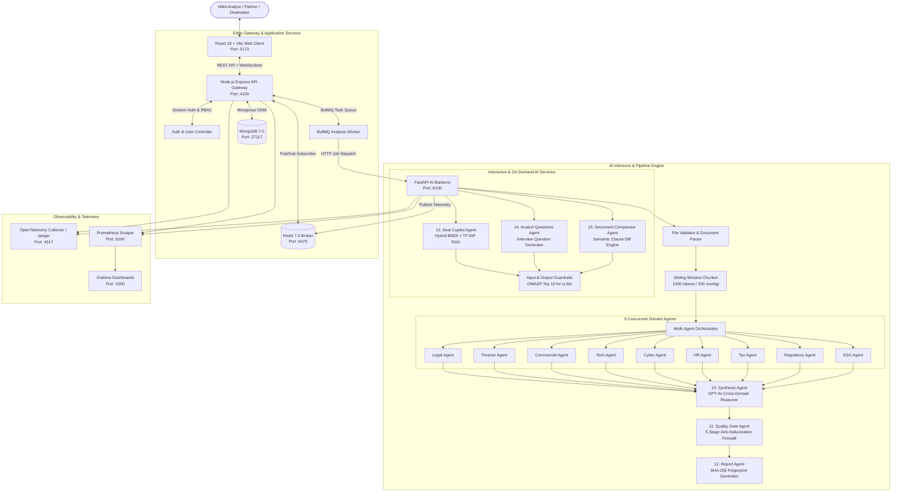

# AcquiSense: Autonomous Multi-Agent M&A Due Diligence Platform
## Complete Technical Guide, Architectural Specification & Operations Manual

---

## 1. Executive Summary & Core Value Proposition

### 1.1 The Industry Bottleneck
In traditional Mergers & Acquisitions (M&A), due diligence is a notoriously slow, expensive, and error-prone multi-week process:
- **Siloed Advisory Workflows**: External accounting, corporate law, cybersecurity, tax, and management consulting teams conduct audits in operational isolation with virtually zero cross-disciplinary collaboration.
- **Exorbitant Cost & Latency**: Standard confirmatory diligence requires **3 to 8 weeks** and incurs **\$100,000 to \$500,000+** in professional advisory billables per deal.
- **Catastrophic Blindspots in Compound Risks**: Critical liabilities frequently slip through the cracks when danger lurks at the intersection of multiple domains. For example, an ambiguous intellectual property assignment clause in an employment agreement (Legal) combined with an open-source copyleft dependency in the codebase (Technology) can create an existential copyright lawsuit that directly invalidates forward EBITDA forecasts (Finance).

### 1.2 The AcquiSense Solution
**AcquiSense** is an enterprise-grade, autonomous **Multi-Agent M&A Intelligence Platform** that automates the entire analytical and risk remediation lifecycle:
1. **Multi-Format VDR Ingestion**: Ingests hundreds of Virtual Data Room (VDR) documents (PDF contracts, Excel cap tables and financial models, Word memos, PPTX board presentations, and CSVs).
2. **Parallel 9-Domain Specialist Agents**: Orchestrates 9 domain-expert AI agents running concurrently via Python `asyncio` and LLMs (GPT-4o / GPT-4o-mini).
3. **Cognitive Cross-Domain Synthesis**: Uses high-reasoning synthesis engines (GPT-4o) to surface non-obvious, compound risk patterns that multiply across domain boundaries.
4. **Automated 5-Stage Quality Gate**: Enforces deterministic anti-hallucination verification, checking every finding citation against original raw text substrings.
5. **Human-in-the-Loop Risk Action Center**: Transforms static reports into dynamic, assignable workflow state machines (Open $\rightarrow$ Assigned $\rightarrow$ Remediating $\rightarrow$ Verified $\rightarrow$ Closed) with immutable audit trails.
6. **Deal Copilot & Diligence Tools**: Features an interactive RAG Copilot with hybrid BM25 + TF-IDF retrieval, an Analyst Question Generator for CEO/CFO meetings, and a pairwise Document Comparator.
7. **Instant IC Verdict**: Computes an algorithmic **Go / Caution / No-Go** investment verdict with severity-rated findings (P0–P3), risk heatmaps, and D3 force-directed risk graphs in **under 3 minutes**.

---

## 2. Architectural Evolution: Prototype to Enterprise Platform

AcquiSense has evolved from an initial proof-of-concept into a hardened, multi-tenant enterprise system:

```
┌─────────────────────────────────┐       ┌─────────────────────────────────────────────────────────┐
│     PHASE 1: PROTOTYPE          │       │           PHASE 2: ENTERPRISE PLATFORM (CURRENT)        │
├─────────────────────────────────┤       ├─────────────────────────────────────────────────────────┤
│ • 9 Parallel Domain Agents      │       │ • 16-Agent Fleet (9 Domain + 7 Meta/Governance/Copilot) │
│ • Basic Fast-API BackgroundTask │       │ • Redis-backed BullMQ Distributed Task Queue            │
│ • Ephemeral Redis State         │ ────► │ • Multi-Tenant RBAC (Company / User / Group Permissions)│
│ • Flat Report Generation        │       │ • Risk Action Center (HITL Workflow & Audit Trails)     │
│ • Naive Substring Matching      │       │ • Hybrid BM25 + TF-IDF Cosine Retrieval Engine          │
│ • No Input/Output Filtering     │       │ • OWASP LLM01-LLM08 Input/Output Guardrails + Sanitizer │
│ • Monolithic UI State           │       │ • Deal Copilot, Analyst Questions & Doc Comparator      │
│ • Basic Prometheus Metrics      │       │ • OpenTelemetry Distributed Tracing & SHA-256 Hashes    │
└─────────────────────────────────┘       └─────────────────────────────────────────────────────────┘
```

---

## 3. End-to-End System Architecture & Microservices Topology

The platform uses a **polyglot microservices architecture** optimized for high-concurrency AI pipelines, low-latency WebSocket communication, robust job queuing, and strict enterprise security boundaries.



---

## 4. Comprehensive Agent Fleet Deep-Dive: All 16 Specialized AI Agents

AcquiSense employs **16 distinct AI and governance agents**:
- **9 Domain Specialist Agents**: Execute concurrently during the raw document analysis phase.
- **7 Meta, Governance, Synthesis & Interactive Agents**: Handle cross-domain reasoning, hallucination elimination, reporting, conversational search, question generation, semantic diffing, and execution orchestration.

```
┌────────────────────────────────────────────────────────────────────────────────────────┐
│                                   RAW VDR DATA ROOM                                    │
│             PDFs · DOCX · XLSX Financial Models · PPTX Decks · CSVs · Text             │
└───────────────────────────────────────────┬────────────────────────────────────────────┘
                                            │
                                            ▼
┌────────────────────────────────────────────────────────────────────────────────────────┐
│                              FILE VALIDATOR & CHUNKER                                  │
│         Magic-byte MIME verification · CWE-434/22 Traversal & Overlap Chunking         │
└───────────────────────────────────────────┬────────────────────────────────────────────┘
                                            │
                     ┌──────────────────────┴──────────────────────┐
                     ▼                                             ▼
┌─────────────────────────────────────────┐   ┌──────────────────────────────────────────┐
│      9 PARALLEL DOMAIN SPECIALISTS      │   │    INTERACTIVE & ON-DEMAND AGENTS        │
│ 1. Legal Agent       6. HR Agent        │   │ 13. Copilot Agent (Hybrid BM25 RAG)      │
│ 2. Finance Agent     7. Tax Agent       │   │ 14. Analyst Questions Agent (IC Prep)    │
│ 3. Commercial Agent  8. Regulatory Agent│   │ 15. Document Comparator (Semantic Diff)  │
│ 4. Tech Agent        9. ESG Agent       │   │ 16. Orchestrator (Asyncio Dispatcher)    │
│ 5. Cyber Agent                          │   └──────────────────────────────────────────┘
└────────────────────┬────────────────────┘
                     │ Raw Findings
                     ▼
┌────────────────────────────────────────────────────────────────────────────────────────┐
│ 10. SYNTHESIS AGENT (GPT-4o)                                                           │
│  - Cross-domain compounding risk discovery (Finding A × Finding B)                     │
│  - Algorithmic Go / Caution / No-Go investment recommendation                          │
│  - Executive Investment Committee memo narrative generation                            │
└───────────────────────────────────────────┬────────────────────────────────────────────┘
                                            │ Synthesized Candidates
                                            ▼
┌────────────────────────────────────────────────────────────────────────────────────────┐
│ 11. QUALITY GATE AGENT (5-Stage Deterministic Anti-Hallucination Guard)                │
│  - Gate 1: Citation Presence Verification (purges / downgrades uncited items)          │
│  - Gate 2: Quote Grounding against Raw Document Text (exact substring audit)           │
│  - Gate 3: Severity Calibration Audit (requires evidence strings for P0)               │
│  - Gate 4: 9-Domain Completeness Check (ensures uniform coverage)                      │
│  - Gate 5: Cross-Domain Finding Deduplication                                          │
└───────────────────────────────────────────┬────────────────────────────────────────────┘
                                            │ Grounded Findings
                                            ▼
┌────────────────────────────────────────────────────────────────────────────────────────┐
│ 12. REPORT AGENT                                                                       │
│  - Severity & domain risk score normalization (0.0 – 10.0 scale)                       │
│  - Cryptographic SHA-256 fingerprint generation (tamper-evident seal)                  │
│  - Serialization to Redis cache & MongoDB durable document store                       │
└────────────────────────────────────────────────────────────────────────────────────────┘
```

---

### 4.1 BaseAgent Architecture & Analytical Lifecycle

Every domain agent inherits from the abstract class `BaseAgent` (`backend/agents/base_agent.py`):

1. **Intelligent Chunk Batching (`_make_batches`)**:
   - Accepts the complete set of document chunks.
   - Groups chunks into batches of up to `MAX_CHUNKS_PER_CALL = 8` to maximize context density while maintaining a strict 2,000-token safety buffer for the completion.
2. **Provenance & Context Injection (`_build_user_prompt`)**:
   - Injects target and acquirer company metadata.
   - Prepends strict provenance headers: `[FILE: filename.pdf | PAGE: 12 | SECTION: 4.2]`.
   - Appends explicit Pydantic JSON schema output constraints.
3. **Deterministic LLM Execution (`_call_llm`)**:
   - Executes via `AsyncOpenAI` at `temperature=0.1` for maximum reproducibility.
   - Enforces valid JSON through `response_format={"type": "json_object"}`.
   - Measures prompt and completion token counts into Prometheus counters (`AGENT_TOKENS_USED`).
4. **Validation & Finding Instantiation (`_parse_findings`)**:
   - Parses raw responses into strongly typed Pydantic `Finding` instances.
   - Validates each `Citation` (`file`, `page`, `section`, `quote`).
   - Assigns unique UUIDs and parses severity levels (`P0`, `P1`, `P2`, `P3`).
5. **Real-Time Progress Emission (`_emit`)**:
   - Tracks batch progression (`pct: 0% → 50% → 100%`).
   - Dispatches `AgentProgress` callbacks non-blockingly to Redis Pub/Sub (`dd:progress:<job_id>`).
6. **Telemetry & Latency Histograms**:
   - Records execution duration into Prometheus histograms (`AGENT_ANALYSIS_DURATION`).
   - Updates finding count gauges (`AGENT_FINDINGS_COUNT`).

---

### 4.2 The 9 Domain Specialist Pipelines

#### 1. ⚖️ Legal Agent (`LegalAgent`)
- **Persona**: Senior M&A Legal Counsel with 20+ years of transactional experience.
- **Mission**: Scrutinize contracts, governance documents, intellectual property assignments, and litigation dockets.
- **Key Risk Checklists**:
  - *Contractual Pitfalls*: Change-of-control clauses triggering automatic contract termination or debt acceleration; uncapped indemnification clauses; one-sided liability waivers; assignment restrictions; non-compete clauses.
  - *Structural Deal Risks*: Material Adverse Change (MAC) definitions; unfulfillable conditions precedent; overbroad reps & warranties.
  - *Litigation Exposure*: Active/threatened litigation, arbitration proceedings, class actions, and consent decrees limiting future operations.
- **Severity Benchmarks**:
  - **P0**: Core IP unassigned or disputed; automatic contract termination of the primary commercial revenue stream upon acquisition; active material litigation threatening solvency.
  - **P1**: Uncapped customer liability; restrictive non-compete clauses; missing key third-party consents.
  - **P2**: One-sided indemnification; ambiguous termination-for-convenience clauses.
  - **P3**: Minor governing law inconsistencies or standard notice requirements.

#### 2. 💰 Finance Agent (`FinanceAgent`)
- **Persona**: Senior M&A Finance Director & CPA specializing in Quality of Earnings (QoE) and accounting forensics.
- **Mission**: Verify the authenticity of reported revenue, evaluate cash burn runway, assess balance sheet health, and uncover hidden debt.
- **Key Risk Checklists**:
  - *Revenue Quality*: Customer revenue concentration (**>20% from a single customer is P1; >40% is P0**); recurring ARR vs. one-time professional services; aggressive deferred revenue recognition; churn spikes.
  - *Financial Health & Burn*: Net cash burn and runway (critical for venture/growth targets); gross margin compression; non-standard or aggressive EBITDA adjustments (add-backs that mask core operational payroll).
  - *Liabilities & Hidden Debt*: Debt covenants; change-of-control penalty triggers in revolving credit lines; underfunded pension liabilities; earn-out dispute vulnerabilities.
  - *Accounting Quality*: Auditor qualifications or going-concern modifications; frequent auditor turnover; aggressive capitalization of R&D expenses that should be expensed.
- **Severity Benchmarks**:
  - **P0**: Going-concern warning; fraudulent revenue recognition; single-customer concentration >40%.
  - **P1**: Customer concentration >20%; questionable EBITDA add-backs (>15% of EBITDA); undisclosed debt covenants.
  - **P2**: Margin compression trends; working capital seasonality fluctuations.
  - **P3**: Informational accounting policy variances.

#### 3. 📊 Commercial Agent (`CommercialAgent`)
- **Persona**: Senior Commercial Diligence Partner specializing in GTM analysis, customer retention, and market positioning.
- **Mission**: Evaluate the durability of the target's business model, customer stability, market share, and competitive defenses.
- **Key Risk Checklists**:
  - *Customer Retention*: Top 5/10 customer concentration; gross and net revenue retention (NRR); renewal dates clustered within 90 days of anticipated deal closing.
  - *Pricing & Model Viability*: Over-reliance on grandfathered or deeply discounted pricing tiers; single-product vulnerability; pricing power erosion.
  - *Market & Competitive Threats*: Inflated Total Addressable Market (TAM) claims; technological substitution risks; commoditization.
  - *GTM & Channel Dependency*: Exclusive distributor or reseller dependencies; co-sell partner agreements terminating on change of control.
- **Severity Benchmarks**:
  - **P0**: Core product facing rapid market obsolescence; enterprise customer churn exceeding 30% annually.
  - **P1**: Net retention under 90%; key customer renewal cliff immediately post-close.
  - **P2**: High channel partner dependency; pricing discount compression.
  - **P3**: Minor regional market variances.

#### 4. 💻 Technology Agent (`TechAgent`)
- **Persona**: Chief Technology Officer and M&A technical auditor specializing in software architecture, open-source licensing, and technical debt.
- **Mission**: Uncover hidden software liabilities, evaluate architectural scalability, and calculate post-merger integration costs.
- **Key Risk Checklists**:
  - *Licensing & IP*: **GPL / AGPL copyleft contamination in proprietary commercial codebases (immediate P0 risk)**; unassigned contractor source code; missing third-party commercial licenses.
  - *Architecture & Scalability*: Single Points of Failure (SPOF) in cloud infrastructure; database bottlenecks; monolithic systems requiring total rewrites; absence of disaster recovery.
  - *Technical Debt*: Legacy frameworks past End-Of-Life (EOL); test coverage <30%; absent automated CI/CD deployment pipelines.
- **Severity Benchmarks**:
  - **P0**: AGPL copyleft license contamination in core proprietary SaaS; architecture incapable of handling projected transaction volumes.
  - **P1**: Critical technical debt requiring >\$1M rewrite; SPOF in primary transactional database.
  - **P2**: Lack of automated integration testing; severe cloud vendor lock-in.
  - **P3**: Documentation gaps or minor dependency version lag.

#### 5. 🔒 Cybersecurity Agent (`CyberAgent`)
- **Persona**: Chief Information Security Officer (CISO) and cybersecurity diligence auditor.
- **Mission**: Detect past security breaches, audit security posture, verify privacy compliance, and assess software supply chain risk.
- **Key Risk Checklists**:
  - *Incident History*: Disclosed or undisclosed data breaches, ransomware incidents, business email compromises, and regulatory investigations.
  - *Privacy & Compliance*: Non-compliance with GDPR, CCPA/CPRA; missing Standard Contractual Clauses; unconsented sharing of customer PII.
  - *Security Posture*: Absence of SOC 2 Type II or ISO 27001 certifications; unmediated critical penetration test vulnerabilities; missing Multi-Factor Authentication (MFA) across production systems; lack of EDR.
  - *Supply Chain Vulnerabilities*: Severe unpatched CVEs in dependencies; exposed API credentials or cloud storage buckets.
- **Severity Benchmarks**:
  - **P0**: Active ongoing data breach; formal regulatory enforcement with material fines; critical unauthenticated RCE CVE exposed to the public internet.
  - **P1**: Unremediated high-severity penetration test findings older than 90 days; total lack of SOC 2 compliance in enterprise B2B.
  - **P2**: Incomplete MFA enforcement across employee accounts; missing privacy disclosures.
  - **P3**: Security configuration best-practice improvements.

#### 6. 👥 Human Resources Agent (`HRAgent`)
- **Persona**: Chief People Officer and organizational diligence expert.
- **Mission**: Evaluate key-person reliance, uncover labor law liabilities, and assess executive compensation friction.
- **Key Risk Checklists**:
  - *Key-Person Dependency*: Founders or core architects without employment agreements, non-competes, or IP assignments; absence of succession planning.
  - *Labor Law & Worker Classification*: **Misclassification of full-time employees as independent 1099 contractors (exposing the buyer to significant back taxes and DOL penalties)**; FLSA wage and overtime violations.
  - *Equity & Golden Parachutes*: Single-trigger equity acceleration upon change of control; excessive golden parachute severance guarantees.
  - *Turnover & Culture*: **Voluntary employee turnover >25% (P1)**; pending Equal Employment Opportunity (EEO) complaints.
- **Severity Benchmarks**:
  - **P0**: Sole architect of core IP has no employment agreement or IP assignment and has announced intention to resign upon acquisition.
  - **P1**: Widespread contractor misclassification; single-trigger equity acceleration for the entire executive bench.
  - **P2**: Turnover rate between 20%–25%; unstandardized performance review structures.
  - **P3**: Minor personnel file documentation inconsistencies.

#### 7. 📋 Tax Agent (`TaxAgent`)
- **Persona**: Senior M&A Tax Counsel and CPA specializing in transaction tax structuring and state/local tax (SALT).
- **Mission**: Identify historical unassessed tax exposures, evaluate tax attribute survival, and audit international transfer pricing.
- **Key Risk Checklists**:
  - *Historical Tax Exposures*: Open audit years with aggressive tax positions; unfiled returns in jurisdictions with physical presence; uncollected sales and use tax post-*South Dakota v. Wayfair*.
  - *Tax Attribute Impairment*: Net Operating Loss (NOL) carryforwards subject to annual limitation under **IRC Section 382** due to ownership change; Section 280G golden parachute excise taxes.
  - *International Tax*: Non-arm's-length intercompany transfer pricing; Permanent Establishment (PE) exposure from remote international workers without local corporate registration.
- **Severity Benchmarks**:
  - **P0**: Material unquantified historical tax fraud; systemic sales tax non-collection exceeding 5% of enterprise value.
  - **P1**: Quantifiable historical tax liabilities exceeding 1% of deal value; forfeiture of major Section 382 NOLs.
  - **P2**: Minor transfer pricing documentation deficiencies.
  - **P3**: Standard timing differences in depreciation schedules.

#### 8. 🏛️ Regulatory Agent (`RegulatoryAgent`)
- **Persona**: Senior Regulatory Counsel specializing in antitrust, trade sanctions, national security (CFIUS), and sector compliance.
- **Mission**: Verify license transferability, audit agency compliance, and identify merger control thresholds.
- **Key Risk Checklists**:
  - *Licenses & Operating Authority*: Non-transferable operational licenses; telecom (FCC), healthcare (FDA/CMS), financial money transmitter licenses (MTL), or defense clearances (ITAR/EAR).
  - *Antitrust & Merger Control*: Mandatory pre-closing merger filings under the **Hart-Scott-Rodino (HSR) Act** in the US, EU Merger Regulation (EUMR), or UK CMA; high market concentration risking a Second Request.
  - *National Security & Sanctions*: **CFIUS review jurisdiction** (if foreign acquirer is buying US critical technology or infrastructure); OFAC trade sanctions violations.
- **Severity Benchmarks**:
  - **P0**: Acquisition subject to likely antitrust injunction or CFIUS veto; core operating license statutorily non-transferable on change of control.
  - **P1**: Mandatory multi-jurisdiction merger filings required with divestiture remedies; active formal SEC/DOJ inquiry.
  - **P2**: Routine regulatory permit transfer notifications.
  - **P3**: Informational license renewal notices.

#### 9. 🌱 ESG Agent (`ESGAgent`)
- **Persona**: Senior ESG Diligence Director and Environmental Sustainability Auditor.
- **Mission**: Uncover environmental remediation liabilities, supply chain social violations, and corporate governance failures.
- **Key Risk Checklists**:
  - *Environmental Liabilities*: Historical contamination; Superfund (CERCLA) cleanup liabilities; ongoing environmental agency citations.
  - *Supply Chain & Social*: **Forced labor or child labor violations in supply chains (automatic P0 under Uyghur Forced Labor Prevention Act)**; severe OSHA safety violations.
  - *Corporate Governance*: Related-party transactions on non-market terms; lack of independent board oversight; Foreign Corrupt Practices Act (FCPA) or UK Bribery Act violations.
- **Severity Benchmarks**:
  - **P0**: Confirmed forced labor in active supply chain; catastrophic uncontained toxic environmental contamination.
  - **P1**: Material OSHA willful violations; systemic board self-dealing; unquantified CERCLA liability.
  - **P2**: Scope 1-3 carbon reporting deficiencies.
  - **P3**: Best-practice sustainability disclosure recommendations.

---

### 4.3 The 7 Meta, Governance, Synthesis & Interactive Agents

#### 10. 🔗 Synthesis Agent (`SynthesisAgent` — Powered by GPT-4o)
- **Role**: Cognitive synthesis engine that connects findings across all 9 domains to uncover compound risks and calculate the overall deal verdict.
- **Connection Typologies**:
  - `compounding_risk`: Finding A multiplies the financial or legal severity of Finding B.
  - `same_subject`: Multiple domains identifying different symptoms of the same root failure (e.g. Finance notes revenue drop, Commercial notes customer churn, Tech notes database outages).
  - `conflict`: Contradictions between domains (e.g. Management claims zero litigation in Legal, but Finance shows a \$5M litigation reserve accrual).
  - `dependency`: One domain's resolution strictly depends on resolving another domain's finding.
- **Algorithmic Go / Caution / No-Go Decision Logic**:
  ```python
  if p0_count >= 1 or (p1_count >= 3 and p1_domains >= 3) or compound_p0_count >= 1:
      verdict = "NO-GO"
  elif p1_count >= 1 or p2_count >= 5:
      verdict = "CAUTION"
  else:
      verdict = "GO"
  ```
- **Executive Narrative**: Synthesizes a 3–5 sentence Investment Committee memo summarizing primary deal hazards, valuation implications, and closing conditions.

#### 11. 🛡️ Quality Gate Agent (`QualityGateAgent`)
- **Role**: The 5-stage automated anti-hallucination firewall.
- **The 5 Defensive Gates**:
  1. **Gate 1 — Citation Presence**: Verifies every finding has $\ge 1$ citation. Uncited P0/P1s are downgraded to P2 with logged warnings; uncited P2/P3s are purged.
  2. **Gate 2 — Quote Grounding**: Performs substring verification of verbatim quotes against raw document chunks. Unmatched quotes are flagged in the audit log as hallucination risks.
  3. **Gate 3 — Severity Calibration**: Audits all P0 findings to verify they contain substantial explanations (`description > 50 chars` and `evidence > 50 chars`). Unsubstantiated P0s are downgraded to P1.
  4. **Gate 4 — Completeness**: Confirms all 9 domains are accounted for; injects clean default states for domains with zero findings.
  5. **Gate 5 — Deduplication**: Scans the unified registry for duplicate finding IDs across disparate domains, preserving original entries.

#### 12. 📊 Report Agent (`ReportAgent`)
- **Role**: Normalizes, structures, and signs the complete analytical dataset into an immutable JSON report.
- **Key Responsibilities**:
  - Calculates exact severity distributions (`P0`, `P1`, `P2`, `P3`).
  - Computes normalized domain risk scores on a standard 0.0 to 10.0 scale.
  - **Cryptographic Fingerprint**: Generates a canonical SHA-256 hash of the complete report payload (`reportHash`) for tamper detection.
  - Stores the report in Redis (`SETEX dd:result:<job_id>`) and signals the Node.js gateway to persist into MongoDB's `reports` collection.

#### 13. ⚡ Deal Copilot Agent (`CopilotAgent` — `copilot_agent.py`)
- **Role**: Permission-aware, citation-grounded RAG agent that answers analyst inquiries regarding the deal.
- **Pipeline Stages**:
  1. `InputGuardrail`: Sanitizes and validates user queries, blocking prompt injection attacks.
  2. `QueryRouter`: Classifies query intent against a domain keyword taxonomy to prioritize target domains.
  3. `RetrievalEngine`: Executes hybrid BM25 + TF-IDF cosine similarity search over findings and raw chunks.
  4. `ContextBuilder`: Assembles retrieved findings and document citations into a token-capped prompt context.
  5. `LLM Call (GPT-4o)`: Synthesizes responses grounded strictly in retrieved context and chat history.
  6. `OutputGuardrail`: Scans output for sensitive data leaks (DLP) and validates that citations match source findings.

#### 14. ❓ Analyst Questions Agent (`AnalystQuestionsAgent` — `analyst_questions_agent.py`)
- **Role**: Automatically generates structured management interview questions from deal findings for IC prep.
- **Output Structure**:
  - Specific, sharp questions referencing exact numbers and contracts from findings.
  - Explicit **Rationale** linking back to finding IDs.
  - **"What to Look For in the Answer"**: Highlights satisfactory responses versus evasive red flags.

#### 15. 📑 Document Comparator Agent (`DocumentComparatorAgent` — `document_comparator_agent.py`)
- **Role**: Semantic side-by-side comparison of two versions of a deal document (e.g., 2024 Audited Accounts vs. 2025 Management Accounts).
- **Output Structure**:
  - Categorizes changes into `changed`, `new`, and `removed` clauses/figures.
  - Classifies severity (`high`, `medium`, `low`) and business category (`financial`, `legal`, `operational`, `risk`).
  - Evaluates overall deal **Risk Direction**: `improving`, `deteriorating`, or `stable`.
  - Formulates strategic management follow-up questions regarding variances.

#### 16. 🚀 Orchestrator (`Orchestrator` — `orchestrator.py`)
- **Role**: Parallel execution coordinator that manages the lifecycle of the 9 domain agents.
- **Capabilities**:
  - Concurrent dispatch via `asyncio.gather()`.
  - **Fault Isolation**: Wraps each agent in dedicated `try/except` blocks; if one agent fails (e.g. rate limit), remaining 8 agents complete unhindered.
  - Relays asynchronous progress percentages to Redis Pub/Sub channels.

---

## 5. Core Systems & Advanced Platform Features

### 5.1 Hybrid BM25 + TF-IDF Retrieval Engine (`retrieval_engine.py`)
To power the Deal Copilot and citation verification, AcquiSense uses a **Hybrid Retrieval Engine** combining lexical precision with statistical semantic similarity:
- **BM25 (`rank_bm25`)**: Delivers keyword precision, essential for finding exact contract clauses, capitalized party names, and statute codes (e.g., "Section 382", "Delaware Court of Chancery").
- **TF-IDF Cosine Similarity (`scikit-learn`)**: Captures broader semantic relationships and handles synonyms (e.g., matching "revenue decline" with "income reduction").
- **Weighted Score Fusion**:
  $$\text{Fused Score} = \alpha \cdot \text{BM25}_{\text{norm}} + (1 - \alpha) \cdot \text{Cosine}_{\text{norm}}$$
  *(Default $\alpha = 0.6$, prioritizing lexical accuracy for legal/financial contexts).*

```
Query ──► Tokenize ──┬──► BM25 Index       ──► Normalized BM25 Score   (weight: 0.6) ──┬──► Fused Relevance Score ──► Top-K
                     └──► TF-IDF Vectorizer ──► Normalized Cosine Score (weight: 0.4) ──┘
```

---

### 5.2 Enterprise Security, File Validation & LLM Guardrails (`guardrails.py`, `file_validator.py`)
AcquiSense enforces security at both the transport/ingestion layer and the generative AI layer:

#### LLM Guardrails (Addressing OWASP Top 10 for LLMs)
- **Input Guardrail (`InputGuardrail`)**:
  - **OWASP LLM01 (Prompt Injection)**: Regex-based pattern matching detects instruction overrides ("ignore previous instructions", "disregard system prompt"), role-playing jailbreaks ("DAN mode", "pretend you are an unrestricted AI"), system delimiter injections (`<<<SYSTEM>>>`), and system prompt leakage attempts.
  - **Length & Budget Defense**: Rejects queries exceeding 2,000 characters to prevent context-overflow denial of service.
  - **Enforcement Actions**: `ALLOW`, `WARN` (sanitizes input and continues), `TRUNCATE`, or `BLOCK` (aborts execution before reaching the LLM).
- **Output Guardrail (`OutputGuardrail`)**:
  - **OWASP LLM06 (Sensitive Data Disclosure / DLP)**: Scans generated text for Social Security Numbers (SSN), credit card PANs, JWT tokens, private RSA keys, and API keys.
  - **OWASP LLM02 (Insecure Output)**: Validates that returned citations reference genuine findings and filters unverified claims.

#### Ingestion Security (`file_validator.py`)
- **CWE-434 (Unrestricted File Upload)**: Performs **magic-byte inspection** of file headers (e.g. verifying `%PDF-` signature for PDFs, `PK\x03\x04` for Office OpenXML documents). Renaming `malware.exe` to `contract.pdf` is immediately blocked.
- **CWE-22 (Path Traversal)**: Sanitizes filenames using strict alphanumeric whitelisting and regex stripping of `../`, `..\\`, and absolute path roots.
- **Storage Quotas**: Enforces 50 MB per-file limits and 250 MB aggregate per-deal data room quotas.

---

### 5.3 Distributed Task Queue & Resiliency with BullMQ (`analysisQueue.js`)
To guarantee that long-running analyses survive server restarts and scale horizontally:
- **BullMQ on Redis**: Replaces in-process background tasks with a persistent Redis queue (`dd-analysis`).
- **Restart Survival**: If the Node.js server or container restarts mid-analysis, active jobs remain safely in the Redis queue and resume when workers restart.
- **Concurrency Control**: Throttles simultaneous AI analyses to a maximum of 3 concurrent jobs to prevent OpenAI rate limits and CPU spikes.
- **Automatic Retries**: Implements 3 retry attempts with exponential backoff (`delay = 5000 * 2^attempt`).
- **Dead Letter Queue (DLQ)**: Permanently failed jobs are routed to a DLQ for operational investigation.

---

### 5.4 Multi-Tenant Organization, User Management & RBAC (`authRoutes.js`, `userRoutes.js`, `groupRoutes.js`)
AcquiSense features a full enterprise multi-tenancy and Role-Based Access Control (RBAC) architecture:
- **Tenant Isolation**: Every `Deal`, `User`, and `Group` belongs to a specific `Company`. Middleware validates that requesting users can only access resources belonging to their own organization.
- **Fine-Grained Permissions**:
  - Deals: `deal:create`, `deal:read`, `deal:update`, `deal:delete`
  - Jobs: `job:create`, `job:read`, `job:update`, `job:delete`, `job:sync`
  - Findings & RAC: `finding:read`, `finding:update`, `finding:assign`, `finding:review`
  - Administration: `user:*`, `group:*`, or wildcard `*`
- **Security & Tokens**: Passwords hashed with `bcryptjs` (salt rounds = 10); sessions managed via signed JWT tokens (7-day expiration).

---

### 5.5 Risk Action Center & Human-in-the-Loop (HITL) Workflow State Machine (`findingRoutes.js`, `RiskActionCenter.jsx`)
The Risk Action Center transforms raw AI findings into persistent, collaborative remediation items:

```
[ AI Synced Finding ] ──► OPEN ──► ASSIGNED ──► REMEDIATING ──► VERIFIED ──► CLOSED
                             │          │              │             ▲
                             └──────────┴──────────────┴─────────────┘
                                       (Conditions & Audit Log)
```

- **Workflow States**:
  - `open`: Newly synced finding awaiting triage.
  - `assigned`: Delegated to a specific analyst with a target due date.
  - `remediating`: Target company management providing clarifying documents or revised covenants.
  - `verified`: Acquirer legal/financial counsel confirms risk mitigation.
  - `closed`: Finding formally resolved or waived by the Investment Committee.
- **Human-in-the-Loop (HITL) Review States**:
  - `ai_generated`: Original AI finding.
  - `confirmed`: Analyst approves the AI finding as accurate.
  - `modified`: Analyst edits the title, description, or severity with justification. Original AI text is preserved in `originalAITitle` and `originalAIDesc` for auditability.
  - `rejected`: Analyst marks the finding as an invalid risk or false positive.
- **Conditions & Covenants**: Allows adding contract conditions precedent (e.g., "Must obtain landlord consent prior to closing").
- **Immutable Audit Trail**: Every status transition, assignment, modification, and review action appends an immutable entry to `finding.auditLog` containing timestamp, user email, action, previous value, new value, and notes.

---

### 5.6 Interactive Deal Copilot with Citations (`copilot_agent.py`, `CopilotPanel.jsx`)
- **Slide-Out Forensic Drawer**: Accessible via keyboard shortcut or floating lightning button.
- **Grounded Responses**: Every answer includes clickable citation badges that direct the user to specific findings and underlying contract text.
- **Suggested Forensic Queries**: Pre-configured query catalog for quick analysis of valuation impact, management questions, and compound risks.

---

### 5.7 Analyst Questions & Management Presentation Prep (`analyst_questions_agent.py`, `AnalystQuestions.jsx`)
- **Executive Question Cards**: Domain-categorized cards displaying severity, question text, rationale, and linked finding IDs.
- **Forensic Guidance**: Detailed "What to look for in the answer" breakdown distinguishing credible management answers from deceptive deflections.

---

### 5.8 Pairwise Document Comparator & Risk Trajectory Engine (`document_comparator_agent.py`, `DocumentComparator.jsx`)
- **Semantic Diff Matrix**: Select any two documents from the data room (e.g., 2024 vs. 2025 financial statements) for automated clause-by-clause diffing.
- **Trajectory Indicator**: Evaluates whether the risk profile is `improving`, `deteriorating`, or `stable`.
- **Materiality Filtering**: Filters cosmetic formatting noise and focuses strictly on commercial terms, liability caps, EBITDA adjustments, and new liabilities.

---

### 5.9 Global Command Palette & Keyboard Navigation (`CommandPalette.jsx`)
- **Universal Shortcut (`Cmd+K` / `Ctrl+K` or `/`)**: Instant overlay powered by `cmdk`.
- **Fast Navigation**: Jump between active deals, switch between all 8 deal tabs, trigger Copilot, or navigate routes without taking hands off the keyboard.

---

### 5.10 Cryptographic SHA-256 Report Verification & Tamper Detection
- **Tamper-Evident Seal**: When `ReportAgent` compiles the report, it computes a canonical SHA-256 hash across domains, findings, and verdicts.
- **Integrity Validation**: When the client loads a report, it verifies the local payload hash against the database seal. Any unauthorized modification in transit or at rest triggers a security warning badge.

---

## 6. Full-Stack Tech Stack & Tooling Matrix

| Layer | Technology | Version | Purpose & Rationale |
| :--- | :--- | :--- | :--- |
| **Frontend Framework** | **React** | 18.2 | Component-driven UI with fine-grained functional state management. |
| **Build Tool** | **Vite** | 5.4 | Sub-second Hot Module Replacement (HMR) and optimized Rollup bundling. |
| **Command Palette** | **cmdk** | 1.0 | Fast, accessible keyboard-driven navigation overlay. |
| **Icons & Animation** | **Lucide React + Motion** | Latest | Consistent icon system and spring-physics animations. |
| **Data Visualization** | **D3.js** | 7.9 | Interactive Force-Directed network graph for cross-domain risk connections. |
| **Styling** | **Custom CSS Variables** | CSS3 | Dark-mode tokenized design system with glassmorphism and spotlight hover tracking. |
| **API Gateway** | **Node.js + Express** | 20 LTS | High-throughput asynchronous gateway handling REST routing and file uploads. |
| **Task Queue** | **BullMQ** | 5.40 | Redis-backed distributed task queue with retry logic and server restart survival. |
| **WebSockets** | **Socket.IO** | 4.7 | Low-latency duplex streaming of per-agent progress events to the browser. |
| **Authentication** | **JWT + bcryptjs** | Latest | Secure token authentication with bcrypt password hashing and RBAC checks. |
| **Database** | **MongoDB** | 7.0 | Document store for deals, jobs, reports, findings, users, groups, and audit trails. |
| **In-Memory Cache** | **Redis** | 7.0 | High-speed cache, BullMQ task backend, and Pub/Sub message broker. |
| **AI Backend** | **FastAPI (Python)** | 3.11 | High-concurrency asynchronous Python framework for AI agent execution. |
| **LLM Inference** | **OpenAI API** | GPT-4o / GPT-4o-mini | Domain analysis (mini) and high-reasoning synthesis/Copilot (GPT-4o). |
| **Hybrid Retrieval** | **rank_bm25 + scikit-learn** | Latest | Hybrid BM25 keyword matching and TF-IDF cosine similarity search. |
| **Data Validation** | **Pydantic** | 2.6 | Strict type enforcement and JSON schema validation for all agent payloads. |
| **Document Parsers** | **pypdf, python-docx, openpyxl** | Latest | Multi-format parsing across PDF, DOCX, XLSX, CSV, and text. |
| **Metrics & Telemetry**| **Prometheus** | 2.51 | Scraping active jobs, token burn rates, agent latency, and error counters. |
| **Distributed Tracing**| **OpenTelemetry** | 1.24 | Distributed request tracing with OTLP export to Jaeger. |
| **Dashboards** | **Grafana** | 10.4 | Pre-provisioned operational and telemetry dashboards. |
| **Containerization** | **Docker & Podman** | Docker v2 / Podman 4+ | Multi-container local orchestration, rootless Podman compose, Kubernetes playbooks, and systemd quadlets. |

---

## 7. Exhaustive Directory Structure & File Inventory

```
e:\projects\Company acquire\
├── docker-compose.yml           # Docker multi-container orchestration specification
├── podman-compose.yml           # Podman rootless compose specification (SELinux :z flags)
├── podman-k8s.yaml              # Podman native Kubernetes Playbook manifest
├── .env                         # Master environment configuration (API keys, ports, secrets)
├── PROJECT_GUIDE.md             # Complete project guide, architecture & operations manual
├── ANDROID_APP_ARCHITECTURE.md  # Complete React Native / Android mobile architecture specification
├── PODMAN_GUIDE.md              # Complete Podman deployment guide (compose, k8s, quadlets)
├── FRONTEND_AUDIT.md            # Detailed frontend architecture and UI/UX audit documentation
│
├── client/                      # Frontend Application (React 18 + Vite)
│   ├── public/                  # Static assets and favicons
│   ├── src/
│   │   ├── assets/              # Branding assets and SVG illustrations
│   │   ├── components/          # Reusable UI component modules
│   │   │   ├── AgentGrid/       # Domain agent progress cards and status grid
│   │   │   ├── AnalystQuestions/# Management interview question generator interface
│   │   │   ├── CommandPalette/  # Global Cmd+K / Ctrl+K keyboard navigation modal
│   │   │   ├── Copilot/         # Sliding Deal Copilot RAG drawer panel
│   │   │   ├── CrossRefGraph/   # D3.js force-directed cross-domain physics graph
│   │   │   ├── DocumentComparator/ # Side-by-side document clause diff interface
│   │   │   ├── FindingsTable/   # Filterable, paginated findings table with citations
│   │   │   ├── GoNoGo/          # Go / Caution / No-Go verdict banner and score ring
│   │   │   ├── RiskActionCenter/# HITL workflow management, assignment & audit trails
│   │   │   └── RiskHeatmap/     # 9-domain by 4-severity interactive risk matrix
│   │   ├── pages/               # Top-level view routes
│   │   │   ├── Dashboard/       # Deal pipeline overview and search dashboard
│   │   │   ├── DealView/        # Comprehensive 8-tab deal investigation workspace
│   │   │   ├── LandingPage/     # Public product landing page with animated metrics
│   │   │   ├── Login/           # User authentication and JWT login interface
│   │   │   ├── NewDeal/         # Multi-file VDR upload and deal setup wizard
│   │   │   ├── Register/        # Organization and admin account registration
│   │   │   └── Reports/         # Historical diligence reports archive
│   │   ├── services/            # Client-side API and networking abstractions
│   │   │   ├── api.js           # Axios REST API client with auth interceptors
│   │   │   ├── auth.js          # LocalStorage JWT token and user session management
│   │   │   └── socket.js        # Socket.IO WebSocket client for live event streaming
│   │   ├── styles/              # Global CSS styling tokens and resets
│   │   │   ├── index.css        # Core design tokens, CSS variables, and glassmorphism
│   │   │   └── App.css          # Navigation bar, layout shell, and status dots
│   │   ├── App.jsx              # Main routing tree, private route guards, and toast provider
│   │   └── main.jsx             # React DOM entry point
│   ├── index.html               # HTML5 shell
│   ├── package.json             # Frontend dependencies and build scripts
│   └── vite.config.js           # Vite development server and API proxy configuration
│
├── server/                      # API Gateway & Backend Services (Node.js + Express)
│   ├── src/
│   │   ├── config/              # Database and connection configuration
│   │   │   └── db.js            # MongoDB Mongoose connection lifecycle manager
│   │   ├── models/              # Mongoose data schemas
│   │   │   ├── Company.js       # Tenant organization schema
│   │   │   ├── Deal.js          # Deal metadata schema
│   │   │   ├── Group.js         # RBAC user groups and permissions schema
│   │   │   ├── Job.js           # Analysis job status and progress schema
│   │   │   ├── Report.js        # Immutable full analysis report schema
│   │   │   ├── User.js          # User account with bcrypt authentication schema
│   │   │   └── index.js         # Unified Mongoose models export and Finding schema
│   │   ├── queues/              # Distributed background task queues
│   │   │   └── analysisQueue.js # BullMQ Redis task queue and worker coordination
│   │   ├── routes/              # Express REST controllers
│   │   │   ├── authRoutes.js    # Register, login, and /me profile routes
│   │   │   ├── dealRoutes.js    # Deal CRUD and status reconciliation endpoints
│   │   │   ├── findingRoutes.js # Risk Action Center, HITL review, and audit trail routes
│   │   │   ├── groupRoutes.js   # Group RBAC management endpoints
│   │   │   ├── jobRoutes.js     # Analysis job submission and queue telemetry
│   │   │   ├── pythonProxyRoutes.js # Proxy routes for Copilot, Questions & Comparator
│   │   │   ├── reportRoutes.js  # Diligence report retrieval endpoints
│   │   │   ├── uploadRoutes.js  # Multer multipart VDR document upload handler
│   │   │   └── userRoutes.js    # User management within organization tenant
│   │   ├── services/            # Auxiliary gateway services
│   │   │   ├── pythonBridge.js  # HTTP client communicating with Python FastAPI engine
│   │   │   ├── redisSubscriber.js # Redis Pub/Sub listener relaying events to WebSockets
│   │   │   └── socketManager.js # Socket.IO connection manager
│   │   ├── syncJobs.js          # Database reconciliation and backfill utility
│   │   └── app.js               # Express application entry point, middleware & health
│   ├── Dockerfile               # Node.js production/development multi-stage Docker build
│   └── package.json             # Server dependencies and lifecycle scripts
│
├── backend/                     # AI Engine & Pipeline (Python 3.11 + FastAPI)
│   ├── agents/                  # Autonomous and Interactive AI Agents
│   │   ├── analyst_questions_agent.py # IC interview question generator
│   │   ├── base_agent.py        # Abstract base agent with batching, retry & metrics
│   │   ├── commercial_agent.py  # Commercial & market risk specialist
│   │   ├── copilot_agent.py     # RAG conversational assistant with guardrails
│   │   ├── cyber_agent.py       # Cybersecurity, breach & compliance specialist
│   │   ├── document_comparator_agent.py # Semantic pairwise clause comparator
│   │   ├── esg_agent.py         # Environmental, social & governance specialist
│   │   ├── finance_agent.py     # Quality of Earnings & financial risk specialist
│   │   ├── guardrails.py        # OWASP LLM01-LLM08 Input & Output Guardrails
│   │   ├── hr_agent.py          # Key-person & labor compliance specialist
│   │   ├── legal_agent.py       # Contract & litigation risk specialist
│   │   ├── orchestrator.py      # Asyncio parallel executor for domain agents
│   │   ├── quality_gate_agent.py# 5-stage deterministic anti-hallucination firewall
│   │   ├── regulatory_agent.py  # Antitrust, trade & licensing specialist
│   │   ├── report_agent.py      # Report compilation & SHA-256 fingerprint generator
│   │   ├── retrieval_engine.py  # Hybrid BM25 + TF-IDF cosine retrieval engine
│   │   ├── synthesis_agent.py   # Cross-domain compound risk reasoner (GPT-4o)
│   │   └── tax_agent.py         # Tax liabilities & transfer pricing specialist
│   ├── api/                     # FastAPI HTTP routing and schemas
│   │   ├── file_validator.py    # Magic-byte MIME & path traversal validation
│   │   ├── routes.py            # AI endpoints (/analyze, /status, /results, /copilot)
│   │   └── schemas.py           # Pydantic v2 schemas for all requests and responses
│   ├── ingestion/               # Document ingestion and processing
│   │   ├── chunker.py           # Sliding-window token chunker (1000/200 tokens)
│   │   └── parser.py            # Multi-format parser (PDF, DOCX, XLSX, CSV, TXT)
│   ├── monitoring/              # Observability and telemetry
│   │   ├── metrics.py           # Prometheus counters, gauges, and histograms
│   │   └── tracing.py           # OpenTelemetry distributed tracing setup
│   ├── pipeline/                # End-to-end execution coordination
│   │   └── runner.py            # Complete pipeline runner orchestrating 12 stages
│   ├── Dockerfile               # Python 3.11 FastAPI container definition
│   ├── main.py                  # FastAPI application entry point
│   └── requirements.txt         # Python dependencies
│
├── infra/                       # Infrastructure & Deployment Manifests
│   ├── mongo/                   # MongoDB initialization script (collections, indexes)
│   └── podman/quadlets/         # Podman Systemd Quadlet unit files (.pod, .container)
│
├── grafana/                     # Observability & Dashboards
│   ├── provisioning/            # Auto-provisioned Prometheus datasources
│   └── dashboards/              # JSON dashboards for system health & AI latency
│
├── prometheus/                  # Metrics Collection Engine
│   └── prometheus.yml           # Prometheus scrape configurations
│
└── scripts/                     # Operational & Testing Utilities
    ├── generate_test_data.py    # Generates synthetic M&A VDR test data rooms
    ├── podman-up.ps1            # Windows PowerShell automated Podman orchestrator
    ├── podman-down.ps1          # Windows PowerShell Podman teardown script
    ├── podman-up.sh             # Linux/macOS automated Podman orchestrator
    └── podman-down.sh           # Linux/macOS Podman teardown script
```

---

## 8. REST API, WebSocket & Event Specifications

### 8.1 Node.js Gateway Endpoints (`:4100`)

#### Authentication & Organization (`/api/auth`)
- `POST /api/auth/register` — Registers a new company tenant and initial administrator user.
- `POST /api/auth/login` — Authenticates credentials; returns JWT token and user profile.
- `GET /api/auth/me` — Returns current authenticated user, company, and permissions.

#### Deals Management (`/api/deals`)
- `GET /api/deals` — Lists all deals for the authenticated user's company (sorted newest first).
- `GET /api/deals/:id` — Retrieves detailed deal information with latest job status reconciliation.
- `POST /api/deals` — Creates a new deal record with target/acquirer names and model profile.
- `PATCH /api/deals/:id` — Updates deal metadata or file associations.
- `DELETE /api/deals/:id` — Deletes deal and associated records.

#### Document Uploads (`/api/upload`)
- `POST /api/upload?dealId=:id` — Multer multipart upload of VDR documents to `/app/uploads`.

#### Analysis Jobs (`/api/jobs`)
- `POST /api/jobs` — Enqueues an analysis job into the BullMQ task queue.
- `GET /api/jobs/:id` — Returns job execution status and per-agent progress map.
- `GET /api/jobs/:id/results` — Returns full analysis report JSON.
- `GET /api/jobs/queue/health` — Returns BullMQ queue depth and active worker metrics.

#### Risk Action Center & HITL Review (`/api/findings`)
- `POST /api/findings/sync/:jobId` — Syncs AI findings from a completed job into persistent MongoDB records.
- `GET /api/findings/deal/:dealId` — Lists findings for a deal with filters (domain, severity, workflowState, reviewStatus).
- `GET /api/findings/deal/:dealId/summary` — Returns counts aggregated by workflow and review states.
- `PATCH /api/findings/:findingId/action` — Updates workflow state (`open`, `assigned`, `remediating`, `verified`, `closed`), assigns analysts, or attaches conditions.
- `PATCH /api/findings/:findingId/review` — HITL review (`confirmed`, `modified`, `rejected`) with notes.
- `GET /api/findings/:findingId/audit` — Returns full immutable audit trail for a finding.

#### Python AI Proxy Routes (`/api/python`)
- `POST /api/python/copilot/:dealId` — Proxies conversational queries to `CopilotAgent`.
- `GET /api/python/results/:jobId/questions` — Returns generated analyst interview questions.
- `POST /api/python/results/:jobId/compare` — Compares two documents from the data room.

---

### 8.2 Python AI Engine Endpoints (`:8100`)
- `POST /api/analyze` — Initiates the multi-agent pipeline asynchronously.
- `GET /api/status/{job_id}` — Returns live pipeline status and agent progress.
- `GET /api/results/{job_id}` — Returns the final synthesized JSON diligence report.
- `POST /api/copilot/{deal_id}` — Executes hybrid retrieval and grounded GPT-4o Copilot response.
- `GET /api/results/{job_id}/questions` — Generates management interview questions from findings.
- `POST /api/results/{job_id}/compare` — Executes semantic clause comparison between two files.
- `GET /health` — Verifies OpenAI connectivity and operational readiness.

---

### 8.3 Redis Channels & WebSocket Events

#### Redis Pub/Sub Channels
- `dd:progress:<pythonJobId>`: Published by Python agents when progress changes:
  ```json
  {
    "domain": "legal",
    "status": "analyzing",
    "pct": 65,
    "findings_count": 8,
    "error": null
  }
  ```
- `dd:job:<pythonJobId>`: Published when job reaches terminal state (`done` or `failed`).

#### Socket.IO Client Events
- Client joins room: `socket.emit('subscribe_job', pythonJobId)`
- Server streams progress: `socket.on('agent_progress', data)`
- Server emits completion: `socket.on('job_completed', data)`
- Client leaves room: `socket.emit('unsubscribe_job', pythonJobId)`

---

## 9. Database Models & Schema Specifications

### Mongoose Models (MongoDB)

```
┌─────────────────────────────────┐
│            Company              │
├─────────────────────────────────┤
│ _id: ObjectId                   │
│ name: String                    │
│ createdAt: Date                 │
└────────────────┬────────────────┘
                 │ 1:N
                 ▼
┌─────────────────────────────────┐       ┌─────────────────────────────────┐
│             User                │       │             Group               │
├─────────────────────────────────┤       ├─────────────────────────────────┤
│ _id: ObjectId                   │       │ _id: ObjectId                   │
│ email: String (unique)          │       │ name: String                    │
│ password: String (bcrypt)       │       │ permissions: [String]           │
│ company: Ref(Company)           │◄──────┤ company: Ref(Company)           │
│ groups: [Ref(Group)]            │       └─────────────────────────────────┘
└─────────────────────────────────┘
```

#### Finding Schema (`models/index.js`)
```javascript
const FindingSchema = new mongoose.Schema({
  pythonFindingId: { type: String, required: true, index: true },
  dealId:          { type: mongoose.Schema.Types.ObjectId, ref: 'Deal', required: true },
  jobId:           { type: mongoose.Schema.Types.ObjectId, ref: 'Job' },
  pythonJobId:     { type: String },
  domain:          { type: String, required: true },
  severity:        { type: String, enum: ['P0', 'P1', 'P2', 'P3'], default: 'P2' },
  title:           { type: String, required: true },
  description:     { type: String, default: '' },
  evidence:        { type: String, default: '' },
  citations: [{
    file: String, page: Number, section: String, quote: String
  }],
  tags:            [String],
  workflowState: {
    type: String,
    enum: ['open', 'assigned', 'remediating', 'verified', 'closed'],
    default: 'open',
  },
  assignedTo:      { type: String, default: null },
  dueDate:         { type: Date, default: null },
  conditions: [{
    text: String, addedAt: Date, addedBy: String
  }],
  reviewStatus: {
    type: String,
    enum: ['ai_generated', 'confirmed', 'modified', 'rejected'],
    default: 'ai_generated',
  },
  reviewedBy:      { type: String, default: null },
  reviewedAt:      { type: Date, default: null },
  analystNotes:    { type: String, default: '' },
  originalAITitle: { type: String, default: '' },
  originalAIDesc:  { type: String, default: '' },
  auditLog: [{
    action: String, by: String, at: Date, notes: String,
    previousValue: mongoose.Schema.Types.Mixed,
    newValue: mongoose.Schema.Types.Mixed
  }]
}, { timestamps: true });
```

---

## 10. Observability, Metrics & Distributed Tracing

### 10.1 Prometheus Metrics
The Python backend and Node gateway expose rich Prometheus metrics scraped at `:9190`:
- `AGENT_TOKENS_USED`: Counter tracking prompt and completion tokens labeled by `agent`, `model`, and `token_type`.
- `AGENT_ANALYSIS_DURATION`: Histogram tracking execution latency for each domain agent.
- `AGENT_FINDINGS_COUNT`: Gauge tracking findings discovered labeled by `domain` and `severity`.
- `QUALITY_GATE_FAILURES`: Counter tracking failed checks across the 5 defensive gates.
- `HTTP_REQUEST_DURATION_SECONDS`: Latency distribution across API gateway endpoints.

### 10.2 OpenTelemetry Tracing (`tracing.py`)
- Standardized instrumentation across FastAPI, Redis operations, and manual OpenAI call spans.
- Exports OTLP spans to Jaeger (`localhost:4317`) for deep distributed tracing and bottleneck identification.

### 10.3 Grafana Dashboards (`:3200`)
- **System Overview**: Node.js and Python microservice health, memory, CPU, and event-loop lag.
- **AI Analytics**: Token burn rates, hourly costs, per-domain latency, and P0-P3 finding distributions.

---

## 11. Local Setup, Docker Orchestration & Operations Guide

### 11.1 Prerequisites
- **Docker Desktop**: Version 24+ with Compose v2 enabled.
- **Node.js**: Version 20 LTS (optional for local non-container development).
- **Python**: Version 3.11+ (optional for local script execution).
- **OpenAI API Key**: Access to `gpt-4o` and `gpt-4o-mini`.

### 11.2 Environment Configuration (`.env`)
Create or verify your `.env` in the repository root:

```env
# OpenAI Configuration
OPENAI_API_KEY=your-openai-api-key-here
OPENAI_BASE_URL=https://api.aicredits.in/v1

# MongoDB Configuration
MONGO_ROOT_USER=ddadmin
MONGO_ROOT_PASS=ddpassword
MONGO_DB=diligence

# Redis Configuration
REDIS_PASS=redispassword

# Grafana Configuration
GRAFANA_USER=admin
GRAFANA_PASS=grafanapassword

# Model Profiles
OPENAI_MODEL_DOMAIN=gpt-4o-mini
OPENAI_MODEL_SYNTHESIS=gpt-4o
OPENAI_MODEL_REPORT=gpt-4o
MAX_PARALLEL_AGENTS=9
CHUNK_SIZE=1000
CHUNK_OVERLAP=200

# Node.js Server
NODE_ENV=development
PORT=4000
JWT_SECRET=acquise-jwt-secret-change-in-production
```

### 11.3 Starting All Microservices

#### Option A: Using Docker Compose
```bash
# Build and start all 7 containers in detached mode
docker compose up -d --build

# Verify container health
docker compose ps
```

#### Option B: Using Podman (Rootless & Daemonless)
AcquiSense includes full Podman support with SELinux `:z` volume isolation. See [PODMAN_GUIDE.md](file:///e:/projects/Company%20acquire/PODMAN_GUIDE.md) for full details.

```powershell
# Windows PowerShell (Automated):
.\scripts\podman-up.ps1

# Or manually:
podman compose -f podman-compose.yml up -d --build
```

```bash
# Linux / macOS (Automated):
./scripts/podman-up.sh

# Or native Kubernetes manifest:
podman play kube podman-k8s.yaml
```

### 11.4 Port Mapping Reference

| Service | Host Port | Container Port | Purpose | Credentials |
| :--- | :--- | :--- | :--- | :--- |
| **Client (React)** | `5173` | `3000` | Web UI Dashboard | N/A |
| **Node Gateway** | `4100` | `4000` | REST API, BullMQ & WebSockets | Bearer JWT |
| **Python Backend** | `8100` | `8000` | AI Pipeline & OpenAPI (`/docs`) | N/A |
| **Grafana** | `3200` | `3001` | Operational Telemetry Dashboards | `admin` / `grafanapassword` |
| **Prometheus** | `9190` | `9090` | Raw Metrics Time-Series Engine | N/A |
| **MongoDB** | `27117` | `27017` | Document Database Store | `ddadmin` / `ddpassword` |
| **Redis** | `6479` | `6379` | Message Broker & Cache | Pass: `redispassword` |

---

## 12. Comprehensive Interview Masterclass: 22 High-Yield Technical Questions & Exemplary Answers

---

### Category A: System Architecture & Distributed Systems

#### Q1: Why did you architect AcquiSense as a polyglot microservice system (Node.js Gateway + Python AI Engine + Redis + MongoDB) instead of a single backend?
> **Exemplary Answer**:
> "We decoupled the system to align microservices with their optimal runtime profiles:
> 1. **Python AI Engine (FastAPI)**: Python is the standard for AI/ML ecosystems, document processing (`pypdf`, `python-docx`, `openpyxl`), scientific retrieval (`rank_bm25`, `scikit-learn`), and asynchronous orchestration (`asyncio.gather`). It handles CPU- and token-intensive LLM batching.
> 2. **Node.js Gateway (Express + Socket.IO)**: Node's event-driven, non-blocking I/O excels at concurrent multipart file streaming, persistent duplex WebSocket connections to client browsers, and low-latency REST routing without thread starvation.
> 3. **Redis (BullMQ & Pub/Sub)**: Acts as the low-latency message backbone between the Python engine and Node.js gateway. Decoupling the AI pipeline from client connections ensures that even if a client disconnects, long-running analyses continue unimpeded.
> 4. **MongoDB (Document Store)**: M&A due diligence reports are semi-structured, deeply nested JSON documents with variable finding schemas, dynamic citations, and variable workflow conditions. A document store provides schema flexibility without requiring dozens of relational table joins."

---

#### Q2: How does AcquiSense handle long-running AI jobs (2–3 minutes) reliably without HTTP timeouts or dropped jobs on container restarts?
> **Exemplary Answer**:
> "We implemented an asynchronous job queue architecture using **BullMQ on Redis**:
> 1. **Immediate HTTP 202 Acknowledgment**: When a user submits documents, the Node gateway validates the request, enqueues the job into BullMQ, writes a `Job` record with status `queued` in MongoDB, and returns an immediate HTTP 202 with the `jobId`.
> 2. **Restart Survival**: Because BullMQ persists job state in Redis, if the Node.js gateway container restarts or crashes mid-job, the job is not lost; it automatically resumes when workers restart.
> 3. **Real-Time Telemetry via Redis Pub/Sub**: As domain agents progress (`10% → 50% → 100%`), the Python engine publishes lightweight JSON events to `dd:progress:<job_id>`. The Node gateway's `redisSubscriber` relays these events over Socket.IO rooms directly to the client browser.
> 4. **Self-Healing Polling Fallback**: The React client maintains a 2.5s fallback polling interval. If a WebSocket disconnects due to transient network issues, the client reconciles state directly from `GET /api/deals/:id` without user interruption."

---

#### Q3: How do you guarantee data consistency between Redis, MongoDB, and the React frontend if a failure occurs mid-analysis?
> **Exemplary Answer**:
> "We treat **MongoDB as the durable source of truth** and **Redis as the high-speed ephemeral cache and event broker**:
> 1. Redis stores job progress and temporary results with a 24-hour TTL (`JOB_TTL_SECONDS = 86400`).
> 2. When the pipeline finishes, `PipelineRunner` sets the status to `done` and caches the report in Redis.
> 3. The Node gateway listens for completion and idempotently upserts the full report into MongoDB using `Report.findOneAndUpdate({ pythonJobId }, update, { upsert: true })`.
> 4. Furthermore, our `GET /api/deals/:id` endpoint features self-healing reconciliation: if a deal record is stuck in `analyzing` while its associated job has completed, it automatically queries the Python backend, writes the report to MongoDB, and marks the deal as `done`."

---

### Category B: Multi-Agent Orchestration & LLM Engineering

#### Q4: Why did you choose a parallel Fan-Out / Fan-In architecture rather than a sequential chain or an autonomous conversational framework like AutoGen or CrewAI?
> **Exemplary Answer**:
> "In institutional M&A, **latency, determinism, and domain independence** are non-negotiable:
> 1. **Latency Minimization**: Sequential chains (Legal $\rightarrow$ Finance $\rightarrow$ Tech) take $9 \times 2.5\text{ minutes} = 22.5\text{ minutes}$. By fanning out across 9 agents concurrently via `asyncio.gather()`, total analysis duration is bounded only by the single slowest domain agent—completing in ~90 seconds.
> 2. **Token Contamination Prevention**: Autonomous conversational loops where agents debate each other indiscriminately consume tens of thousands of tokens, frequently stray off-topic, and produce compounding hallucinations. In our architecture, the 9 specialists focus strictly on their domain's document excerpts without bias from other domains.
> 3. **Controlled Synthesis (Fan-In)**: Inter-domain interaction is deliberately deferred to the dedicated **Synthesis Agent (GPT-4o)**, which reviews all structured findings at once. This ensures that cross-domain correlation happens with global context rather than piecemeal conversational drift."

---

#### Q5: How does the Synthesis Agent discover cross-domain compounding risks? Can you provide a concrete M&A example?
> **Exemplary Answer**:
> "Single-domain findings often appear minor in isolation but catastrophic in combination.
> The `SynthesisAgent` receives structured findings and summaries from all 9 domains and executes a meta-reasoning prompt using GPT-4o. It evaluates finding pairs across domains for four explicit connection types: `compounding_risk`, `conflict`, `same_subject`, and `dependency`.
>
> **Concrete Deal Example**:
> - *Commercial Finding*: Target company has 45% revenue concentration with a single customer (Flagged as P1).
> - *Legal Finding*: That exact customer's Master Services Agreement contains an immediate termination-for-convenience clause upon change of control (Flagged as P1).
> - *Synthesis Action*: The Synthesis Agent links these findings into a **Compound P0 Risk**: *'The acquirer faces an immediate loss of 45% of top-line revenue upon closing if the customer exercises its change-of-control termination right.'* It elevates the combined severity to P0 and triggers an automatic **NO-GO** verdict."

---

#### Q6: What is the Go / Caution / No-Go verdict algorithm, and why isn't it left purely to LLM discretion?
> **Exemplary Answer**:
> "While LLMs are exceptional at qualitative synthesis, purely subjective verdict prompts can produce inconsistent results across runs. To guarantee auditability and regulatory rigor, we implement a **hybrid decision framework**:
> 1. The LLM suggests a verdict based on strict criteria in its prompt.
> 2. The pipeline enforces a deterministic fallback and verification rule in `_compute_go_no_go`:
>    - **NO-GO**: Triggered if there is **$\ge 1$ P0 finding** OR **$\ge 3$ P1 findings across $\ge 3$ distinct domains** OR **$\ge 1$ cross-domain compounding P0 linkage**.
>    - **CAUTION**: Triggered if there are **1–2 P1 findings** OR **$\ge 5$ P2 findings** across the deal.
>    - **GO**: Clean profile containing only manageable P2/P3 operational observations.
> This ensures that an investment committee can mathematically trace why a deal received a NO-GO verdict."

---

#### Q7: How do you eliminate hallucinations in high-stakes financial and legal findings?
> **Exemplary Answer**:
> "We tackle hallucinations through a 3-tiered defense-in-depth approach:
> 1. **Low-Temperature Determinism**: All domain extraction agents run at `temperature=0.1` with strict Pydantic JSON schemas.
> 2. **Forced Citation & Provenance Extraction**: Agents cannot output an abstract risk; every single `Finding` object is required to contain a `Citation` array specifying `file`, `page`, `section`, and a verbatim `quote` (<200 characters) directly from the text.
> 3. **Deterministic 5-Stage Quality Gate Agent**: After LLM execution, findings are processed by a non-LLM, rule-based audit agent (`QualityGateAgent`):
>    - **Citation Presence Gate**: Purges or downgrades findings lacking document references.
>    - **Quote Grounding Gate**: Performs substring matching of the quoted text against the raw text of the document chunks. If a quote cannot be found in the source text, it is flagged as a potential hallucination.
>    - **Severity Calibration Gate**: Downgrades any P0 finding that lacks substantive evidence (>50 characters)."

---

### Category C: RAG, Retrieval & Document Ingestion

#### Q8: How does your Hybrid Retrieval Engine work, and why combine BM25 with TF-IDF cosine similarity?
> **Exemplary Answer**:
> "In `backend/agents/retrieval_engine.py`, we implement hybrid retrieval because neither lexical nor semantic search alone suffices for M&A documents:
> - **BM25 Alone**: Excels at finding exact keywords, statutory codes, contract section numbers, and company names (e.g. 'Section 382', 'GPL v3'). However, it fails completely on conceptual queries or synonyms (e.g. searching 'revenue leak' will miss sentences stating 'uncollected customer accounts').
> - **Cosine/Dense Alone**: Understands semantic proximity but frequently suffers from false positives on legal jargon, and can dilute exact phrase matching.
> - **Hybrid Fusion**: We normalize both scores and fuse them via:
>   $$\text{Score} = \alpha \cdot \text{BM25} + (1 - \alpha) \cdot \text{Cosine}$$
>   With $\alpha = 0.6$, we prioritize keyword accuracy for legal terms while retaining semantic generalization."

---

#### Q9: How did you implement document parsing and chunking? Why sliding-window chunking over semantic or fixed-character splitting?
> **Exemplary Answer**:
> "M&A data rooms contain heterogeneous files: PDF contracts, scanned board minutes, DOCX memos, and Excel cap tables:
> 1. **Format-Specific Extraction (`parser.py`)**:
>    - PDFs use `pypdf` with page-boundary tracking so every text segment carries its origin page number (`page: 14`).
>    - DOCX extracts structural headings and body paragraphs.
>    - XLSX/CSV converts spreadsheets into formatted string rows preserving column headers.
> 2. **Sliding-Window Chunking (`chunker.py`)**:
>    - Simple character splitting cuts clauses in half, which is catastrophic for legal text (e.g., separating an indemnification clause from its liability cap sentence).
>    - We use a **1,000-token chunk size with a 200-token sliding overlap**. The 20% overlap guarantees that sentences straddling arbitrary token boundaries remain semantically intact in at least one chunk.
>    - Every chunk retains metadata: `file_name`, `page`, `chunk_index`, and `char_offset`."

---

#### Q10: How do you manage OpenAI token limits when a VDR contains hundreds of pages?
> **Exemplary Answer**:
> "We use **hierarchical batching and model tiering**:
> 1. **Batching**: In `BaseAgent._make_batches`, chunks are grouped into batches of up to 8 chunks (~8,000 tokens of input). This fits comfortably within the 128k context window of modern models while keeping prompt costs low and ensuring high attention density.
> 2. **Model Profiling**: We provide 3 runtime profiles in `MODEL_PROFILES`:
>    - `economy`: `gpt-4o-mini` across both domain extraction and synthesis (~$0.05 per deal).
>    - `standard` (Default): `gpt-4o-mini` for the 9 parallel domain agents, and `gpt-4o` for the high-reasoning Synthesis Agent (~$0.35 per deal).
>    - `premium`: Full `gpt-4o` across all 9 agents and synthesis (~$1.80 per deal).
> This tiering allows customers to run initial screenings economically and reserve premium models for late-stage confirmatory diligence."

---

### Category D: Security, Guardrails & Quality Assurance

#### Q11: How does AcquiSense address the OWASP Top 10 for Large Language Models?
> **Exemplary Answer**:
> "In `backend/agents/guardrails.py`, we implement pre- and post-generation guardrails:
> - **OWASP LLM01 (Prompt Injection)**: `InputGuardrail` inspects all user prompts with regex pattern matching to detect instruction overrides ('disregard prior guidelines'), persona attacks ('DAN mode'), system delimiter injections, and prompt leaking attempts. Detected injections are immediately rejected with HTTP 400 (`GuardrailAction.BLOCK`).
> - **OWASP LLM02 (Insecure Output)**: Responses must conform to strict Pydantic models. Malformed JSON is rejected and retried.
> - **OWASP LLM06 (Sensitive Information Disclosure)**: `OutputGuardrail` performs Data Loss Prevention (DLP) scanning on model outputs, sanitizing any discovered SSNs, credit card numbers, JWT tokens, and private API keys.
> - **OWASP LLM08 (Excessive Agency)**: Agents have read-only access to ingested chunks; they cannot trigger file deletion, external network queries, or database writes without human approval."

---

#### Q12: How do you prevent malicious file uploads (e.g., an executable disguised as a PDF or path traversal attacks)?
> **Exemplary Answer**:
> "In `backend/api/file_validator.py`, we implement a strict 5-stage validation gate:
> 1. **Extension Whitelist**: Only permits approved extensions (`pdf`, `docx`, `xlsx`, `csv`, `txt`, `md`).
> 2. **Magic-Byte Signature Inspection (CWE-434)**: Validates binary file signatures (`%PDF-` for PDFs, `PK\x03\x04` for Office ZIP XML). If an attacker renames `malware.exe` to `financials.pdf`, the MIME inspector rejects it immediately.
> 3. **Path Traversal Sanitization (CWE-22)**: Filenames are stripped of directory traversal sequences (`../`, `..\\`), Windows drive letters, and non-whitelisted characters.
> 4. **Size & Quota Limits**: Rejects individual files $>50\text{ MB}$ and data rooms $>250\text{ MB}$ to mitigate denial-of-service."

---

#### Q13: What happens if an individual domain agent crashes or encounters an API rate limit mid-pipeline? Does the entire deal fail?
> **Exemplary Answer**:
> "No, the architecture is designed for **graceful degradation**:
> 1. In `Orchestrator.run_all_agents`, each domain task is wrapped in an individual `try/except` block inside the `asyncio.gather` list.
> 2. If the Tax Agent crashes due to a 429 rate limit or malformed document, the exception is caught, logged, and emits an `AgentStatus.FAILED` event.
> 3. It returns a fallback `DomainFindings(domain=Domain.TAX, summary='Agent failed: ...')` object rather than raising an unhandled exception.
> 4. The remaining 8 agents complete normally, the Quality Gate Agent logs the missing domain under `Gate 4 (Completeness)`, and the Synthesis Agent still computes a verdict on the available data with an explicit audit warning."

---

### Category E: Human-in-the-Loop & Risk Action Center

#### Q14: How does the Risk Action Center work, and why is an immutable audit log critical in M&A?
> **Exemplary Answer**:
> "In institutional M&A, AI reports cannot simply sit as static PDFs; deal teams must track remediations until closing:
> 1. **Workflow State Machine**: In `findingRoutes.js`, findings transition across `open` $\rightarrow$ `assigned` $\rightarrow$ `remediating` $\rightarrow$ `verified` $\rightarrow$ `closed`.
> 2. **HITL Review**: Analysts can `confirm`, `modify`, or `reject` an AI finding. If modified, the original AI text is preserved in `originalAITitle` and `originalAIDesc`.
> 3. **Covenants & Conditions**: Analysts attach actionable deal covenants (e.g. 'Section 4.1 Escrow Holdback').
> 4. **Immutable Audit Trail**: Every action appends an immutable record to `auditLog` capturing `{ action, by, at, notes, previousValue, newValue }`. This provides legal defensibility for investment committees, showing who reviewed, amended, or approved every risk."

---

#### Q15: How does the Document Comparator detect semantic differences rather than simple text diffing?
> **Exemplary Answer**:
> "Traditional diff tools (like `git diff`) operate on character or line matching, which produces massive noise in M&A documents due to paragraph reformatting, font changes, or minor wording tweaks.
> `DocumentComparatorAgent` takes a semantic approach:
> 1. It ingests both documents and instructs GPT-4o with an M&A forensic prompt.
> 2. It groups changes into three material types: `changed` (clause modified), `new` (new liability/clause added), and `removed` (dropped indemnity or protection).
> 3. It categorizes business impact (e.g. 'Liability cap lowered from \$10M to \$2M').
> 4. It computes an overall **Risk Trajectory**: `improving`, `deteriorating`, or `stable`.
> 5. It outputs strategic questions for dealmakers to ask management regarding the discrepancies."

---

### Category F: Frontend Engineering & Interactive UX

#### Q16: How does the React client prevent UI freezing and flickering when handling high-frequency WebSocket progress updates?
> **Exemplary Answer**:
> "In `DealView.jsx`:
> 1. **Functional State Updates**: WebSocket events invoke `setAgentProgress((prev) => ({ ...prev, [event.domain]: event }))`. This avoids stale closure bugs and updates only the changed domain key without re-instantiating the full state tree.
> 2. **User Interaction Guards**: Auto-polling or completion events could previously clobber the user's active tab. We use a `userInteractedRef = useRef(false)`. When a user clicks any tab (Findings, Heatmap, Questions, etc.), this ref is set to `true`, preventing background updates from redirecting them back to the Verdict tab.
> 3. **Defensive Rendering**: Components use optional chaining and fallback empty objects (`domainFindings = report?.domains || {}`), ensuring tabs render without runtime exceptions even before analysis completes."

---

#### Q17: How does the D3.js Cross-Reference Graph work under the hood?
> **Exemplary Answer**:
> "In `CrossRefGraph.jsx`:
> 1. **Physics Simulation Engine**: We instantiate a `d3.forceSimulation(nodes)` combining several physical forces:
>    - `d3.forceLink(links).distance(120)`: Maintains readable spacing between connected findings.
>    - `d3.forceManyBody().strength(-300)`: Applies electrostatic repulsion so unrelated nodes don't overlap.
>    - `d3.forceCenter(W / 2, H / 2)`: Centers the graph in the SVG canvas.
>    - `d3.forceCollide(30)`: Prevents node collisions.
> 2. **Interactive Drag & Tooltips**: Users can drag nodes to reorganize complex clusters (`d3.drag()`), and hovering displays a glassmorphic tooltip with finding titles, domains, and severity badges."

---

#### Q18: How does the Global Command Palette improve analyst productivity?
> **Exemplary Answer**:
> "In `CommandPalette.jsx`, we implemented `cmdk` accessible via `Cmd+K` / `Ctrl+K` or `/`:
> 1. **Zero-Latency Navigation**: Analysts can instantly search across all deals, jump directly to any of the 8 deal tabs, toggle the Copilot panel, or jump to New Deal without clicking through menus.
> 2. **Keyboard-Driven Workflow**: High-frequency dealmakers can triage multiple dossiers rapidly while keeping their hands entirely on the keyboard."

---

### Category G: Observability, Enterprise Scaling & Production Readiness

#### Q19: How do you monitor token expenditure, model latency, and system health in production?
> **Exemplary Answer**:
> "We instrumented Prometheus metrics across the stack (`monitoring/metrics.py`):
> 1. `AGENT_TOKENS_USED`: Counter tracking prompt and completion tokens labeled by `agent`, `model`, and `token_type`.
> 2. `AGENT_ANALYSIS_DURATION`: Histogram tracking exact execution latency per domain.
> 3. `AGENT_FINDINGS_COUNT`: Gauge tracking findings by severity (`P0`, `P1`, `P2`, `P3`).
> 4. `QUALITY_GATE_FAILURES`: Counter tracking failed checks across the 5 gates.
> 5. **OpenTelemetry Distributed Tracing**: FastAPI and OpenAI calls are instrumented with trace IDs exported to Jaeger, allowing us to trace individual LLM latency bottlenecks.
> 6. **Grafana Dashboards**: Real-time dashboards at `:3200` visualize token burn rates, error counts, and queue depth."

---

#### Q20: What is the cryptographic SHA-256 report verification, and what vulnerability does it solve?
> **Exemplary Answer**:
> "In high-stakes M&A, investment decisions rely on report integrity. A rogue actor or compromised server could theoretically alter findings in transit or at rest (e.g. changing a P0 finding to P3 to push a bad deal through).
> When `ReportAgent` compiles the final JSON, it computes a canonical SHA-256 hash across domains, findings, and verdicts, saving it in `reportHash`.
> When the React client loads the report, it recalculates the client-side hash and compares it against the stored hash. If any field has been tampered with, the UI displays a tamper warning badge."

---

#### Q21: How does your multi-tenant RBAC system prevent cross-tenant data leakage?
> **Exemplary Answer**:
> "Every deal, user, group, and finding is scoped to a `companyId`:
> 1. In `server/src/routes/authRoutes.js`, the `authenticateToken` middleware verifies the JWT and attaches `req.user = { id, email, company: { id, name }, groups }`.
> 2. In `findingRoutes.js`, `dealRoutes.js`, and `userRoutes.js`, helper functions (`checkDealAccess`, `checkJobAccess`, `checkFindingAccess`) verify that `resource.companyId.toString() === req.user.company.id`.
> 3. If a user attempts to access a deal ID belonging to another company, the gateway returns HTTP 403 Forbidden.
> 4. Group permissions enforce least privilege: analysts without `job:sync` or `finding:review` permissions are blocked at the route level."

---

#### Q22: If AcquiSense needs to scale to 50,000 deals per month across global private equity firms, what are your next architectural evolutions?
> **Exemplary Answer**:
> "To scale from hundreds to tens of thousands of deals monthly:
> 1. **Distributed Horizontal Workers**: Scale BullMQ analysis workers independently on Kubernetes using KEDA (Kubernetes Event-driven Autoscaling) triggered by Redis queue depth.
> 2. **Dedicated Vector Database**: Replace in-memory hybrid search with **pgvector / Pinecone / Qdrant** with pre-filtering by `companyId` and `dealId` for sub-10ms similarity retrieval across millions of chunks.
> 3. **Cloud Object Storage**: Transition from local Docker volume uploads to **Amazon S3 / Google Cloud Storage** with pre-signed upload URLs and server-side KMS encryption at rest.
> 4. **Multimodal OCR & Table Parsing**: Integrate **LayoutLMv3 / AWS Textract** to parse complex financial balance sheets, cap table spreadsheets, and architectural diagrams directly as structured tables rather than flat text."

---

## 13. Summary & Verification Checklist

- [x] **16 Specialized Agents**: Fully documented (9 domain specialists + 7 meta/governance/interactive agents).
- [x] **Security & Guardrails**: OWASP Top 10 for LLMs input/output guardrails and magic-byte file validation.
- [x] **Hybrid Retrieval**: BM25 + TF-IDF cosine fusion with weighted scoring formula.
- [x] **Distributed Task Queuing**: Redis-backed BullMQ queue with automatic retries and restart survival.
- [x] **Multi-Tenant RBAC**: Company scoping, user groups, and granular permissions.
- [x] **Risk Action Center**: Workflow state machine, HITL review states, covenants, and immutable audit logs.
- [x] **Diligence Tooling**: Deal Copilot, Analyst Question generator, and Document Comparator.
- [x] **Command Palette**: `Cmd+K` / `Ctrl+K` keyboard-driven navigation.
- [x] **Cryptographic Verification**: Canonical SHA-256 tamper-evident report hashing.
- [x] **Observability**: Prometheus metrics, OpenTelemetry distributed tracing, and Grafana dashboards.
- [x] **Technical Interview Masterclass**: 22 rigorously answered architectural, multi-agent, and full-stack questions.
